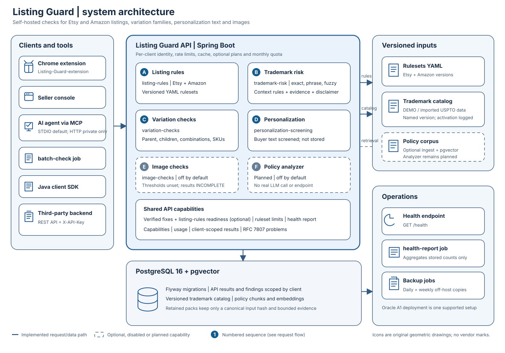

# Listing Guard

Input format adapters: [docs/adapters.md](docs/adapters.md)

[Official agent skill](docs/agent-skill.md)

[](https://github.com/thanhdatpb/Listing-Guard/actions/workflows/ci.yml)
[](https://github.com/thanhdatpb/Listing-Guard/releases/latest)
[](LICENSE)
[](https://github.com/thanhdatpb/Listing-Guard/pkgs/container/listing-guard)

Self-hosted pre-publish compliance API for Etsy and Amazon listings: deterministic rules, explainable trademark risk, built for sellers, tools and AI agents.



The API checks listings and returns findings with their source, field and evidence. Separate endpoints screen variation families, buyer personalization text and listing images.
The API stores results in each client's scope; optional plans, quota and fix/readiness output are disabled by default.
Trademark checks require an operator loaded catalog, and image checks are disabled by default with thresholds still unverified.
The optional console keeps magic-link sign-in by default and can use verified Cloudflare Access identities without SMTP (ADR-027).
Listing Guard suggests and reports. It never edits or publishes a listing and does no SEO.

## What it checks

| Endpoint or capability | What it does | Availability | Evidence status |
|---|---|---|---|
| `POST /api/v1/checks` | Deterministic Etsy and Amazon listing rules | Ready | Each rule carries `verified`, `secondary` or `unverified` sourcing |
| `POST /api/v1/trademark-checks` | Explainable mark matches against the configured versioned catalog | Requires a `READY` catalog | Reference warning, not a legal conclusion; trademark rules and product classes are unverified |
| `POST /api/v1/variation-checks` | Checks parent/child variation structure, combinations and SKUs | Ready | No rule is verified; findings are WARNING or INFO, never ERROR |
| `POST /api/v1/personalization-screenings` | Screens buyer-entered text against a print profile and the trademark catalog | Ready | Profile values are placeholders; text is personal data and is not stored or repeated |
| `POST /api/v1/image-checks` | Checks image properties for Etsy or Amazon | Off by default | Shipped marketplace thresholds are unset; results are INCOMPLETE and images are not recognized for marks or text |
| `GET /api/v1/rulesets/{marketplace}/limits`, `GET /api/v1/capabilities`, `GET /api/v1/reports/summary` | Reads limits, deployment capabilities and stored-result counts | Ready | Read-only; reports do not read listing text |
| `POST /api/v1/policy-checks` | Planned policy-grounded analysis with verified citations | Planned, off by default | No real LLM call or endpoint yet; see [ADR-011](docs/adr/ADR-011-policy-grounded-analyzer.md) |

Rule sources stay labeled as they are in the rulesets; no unverified limit is presented as official. The trademark result includes its disclaimer and is not legal advice. The image checker does not identify logos, text or marks. A missing finding is not marketplace approval.

## How a check flows


1. A client sends `POST /api/v1/checks` with `X-API-Key`.
2. Cloudflare terminates HTTPS and the Cloudflare Tunnel forwards the request to the Oracle A1 Docker Compose deployment (Cloudflare Access protects only `/console/*` and `/health`; `/api/v1/*` is protected by the API key and the rate limit).
3. The API validates the client's API key and applies per-client rate limiting and optional plan/quota checks.
4. The cache identity includes the client, marketplace, pack, input hash, ruleset version and `analysisVersion`.
5. On a cache miss, the API runs the requested pack using its declared ruleset and analysis version.
6. The result and findings are stored under the authenticated client in PostgreSQL; only hashes and bounded evidence are stored for retained sensitive packs.
7. The API returns the findings and evidence, with the ruleset and analysis versions and any applicable disclaimer.

## Use it from AI agents


Build the MCP jar and configure a client key and API URL. STDIO is the default transport; its HTTP transport has no authentication and must stay on loopback or a private network.

```bash
./mvnw -B -pl mcp-server -am package
export LISTING_GUARD_MCP_API_KEY='<client-key>'
export LISTING_GUARD_MCP_BASE_URL='https://listing-api.example.com'
java -jar mcp-server/target/listing-guard-mcp.jar
```

The seven tools are `check_listing`, `check_trademark`, `check_variations`, `screen_personalization`, `get_limits`, `get_usage` and `get_capabilities`. Listing access is read-only: check calls can store API results and may use quota, but no tool edits or publishes a listing. Successful API responses are passed through unchanged; the model does not decide what a finding means. See the [MCP guide](docs/mcp.md).

## Ecosystem

- [REST API](docs/integration-guide.md) for marketplace integrations and seller tools.
- [Chrome extension](https://github.com/thanhdatpb/Listing-Guard-extension) for Etsy editor checks and manual Etsy/Amazon input.
- [MCP server](docs/mcp.md) for Claude Code, Claude Desktop and other MCP clients.
- [Java client SDK](client/README.md) for Java backends.
- [`batch-check`](docs/batch-check.md) for CSV or Amazon flat-file reports.
- The optional web console speaks English and Vietnamese (`LISTING_GUARD_CONSOLE_DEFAULT_LOCALE`, [ADR-028](docs/adr/ADR-028-console-localization.md)); the API does not change.

## Quickstart with Docker

Requirements: Java 21 for the build, Docker for PostgreSQL and the API. The API starts without a model or external API key.

```bash
docker compose up --build -d
docker compose run --rm admin client create demo-client
docker compose run --rm admin key create demo-client --label="first key" # copy the one-time key
curl -X POST http://localhost:8080/api/v1/checks -H 'X-API-Key: <client-key>' -H 'Content-Type: application/json' -d '{"marketplace":"ETSY","listing":{"title":"Handmade Mug","description":"A ceramic mug.","tags":["mug","Mug","gift_idea"],"price":{"amount":1999,"divisor":100,"currency_code":"USD"},"taxonomy_path":["Home & Living","Mugs"]}}'
curl -X POST http://localhost:8080/api/v1/trademark-checks -H 'X-API-Key: <client-key>' -H 'Content-Type: application/json' -d '{"marketplace":"ETSY","listing":{"title":"Handmade Mug","description":"A ceramic mug.","tags":["mug","Mug","gift_idea"],"price":{"amount":1999,"divisor":100,"currency_code":"USD"},"taxonomy_path":["Home & Living","Mugs"]}}'
```

The second request needs an operator configured catalog; without one it returns `503 trademark-not-configured`. See the [integration guide](docs/integration-guide.md) for request formats, error handling and API key management.

## Deploy

See [Oracle A1 behind Cloudflare Tunnel](docs/deploy-oracle.md) for production setup, Access, backups, upgrades and health checks. General production settings are in [deployment](docs/deployment.md). Before the first deployment read [deploy readiness](docs/deploy-readiness.md): what is on or off by default, the environment variables, the resource budget, a security checklist, a smoke test and the manual steps in order. The release notes of the version to deploy are in [docs/releases](docs/releases/v0.8.0.md).

## Roadmap

- Verify the USPTO conversion and run the trademark evaluation on real data ([ADR-009](docs/adr/ADR-009-trademark-risk-scanner.md)).
- Verify the TSDR status check against the real TSDR once a key exists, and decide how its dead-mark report feeds the next catalog sync ([ADR-009](docs/adr/ADR-009-trademark-risk-scanner.md#tsdr-status-check-job-tsdr-status)).
- Review official image thresholds and build bounded image decoding and upload staging ([ADR-008](docs/adr/ADR-008-image-compliance-checker.md)).
- Evaluate retrieval, then implement the optional policy analyzer and real LLM adapter ([ADR-011](docs/adr/ADR-011-policy-grounded-analyzer.md)).
- Continue contract compatibility and Java SDK evolution ([ADR-022](docs/adr/ADR-022-api-contract-and-compatibility.md), [ADR-023](docs/adr/ADR-023-java-client-sdk.md)).
- Review variation sources and real workshop print profiles ([ADR-015](docs/adr/ADR-015-variation-checks.md), [ADR-016](docs/adr/ADR-016-personalization-screening.md)).

See the [detailed status and project guide](docs/overview.md) for implemented behavior and remaining work.

## Documentation

- [Detailed project guide](docs/overview.md)
- [Rulesets and sourcing](docs/rulesets.md)
- [Trademark catalog and USPTO data](docs/trademark-catalog.md)
- [Policy corpus and retrieval](docs/policy-corpus.md)
- [Policy change monitor](docs/policy-monitor.md)
- [Input schema](docs/input-schema.md)
- [Listing health report and batch check](docs/batch-check.md)
- [MCP server](docs/mcp.md)
- [Integration guide](docs/integration-guide.md)
- [Deployment](docs/deployment.md)
- [Oracle A1 deployment](docs/deploy-oracle.md)
- [Deploy readiness](docs/deploy-readiness.md)
- [Architecture decisions](docs/adr/)
- [Release notes](docs/releases/v0.8.0.md)

## License

MIT © 2026 Thanh Dat Tran. See [LICENSE](LICENSE).
