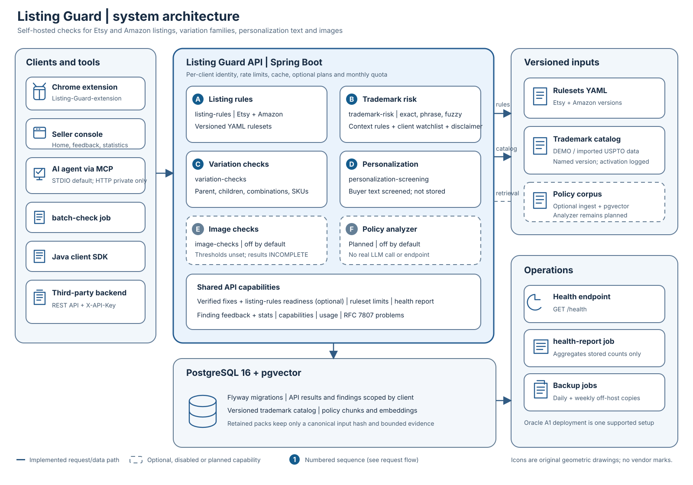
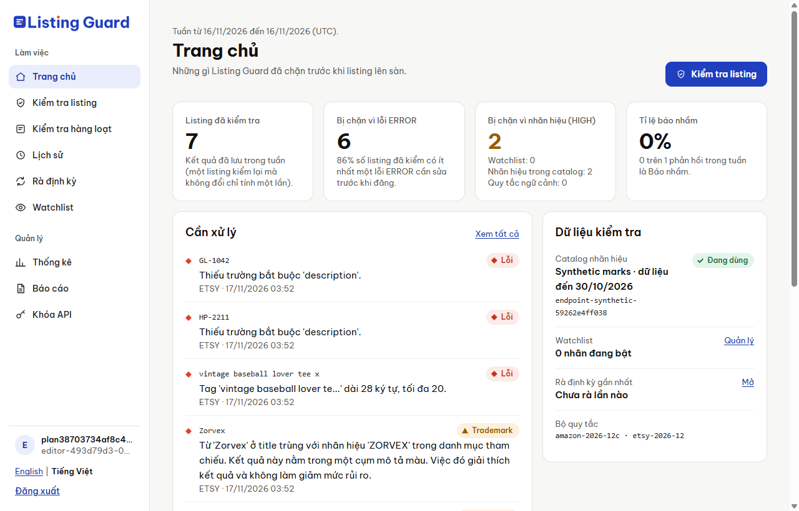
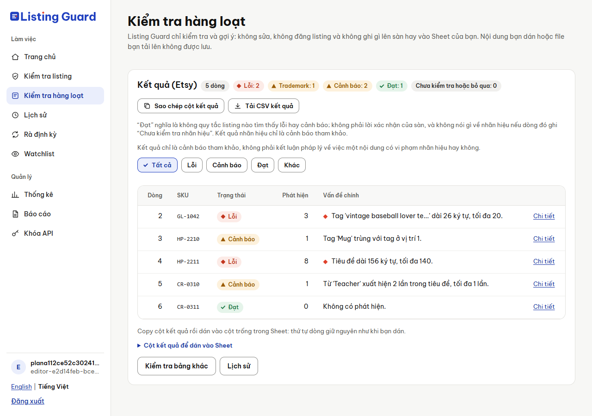
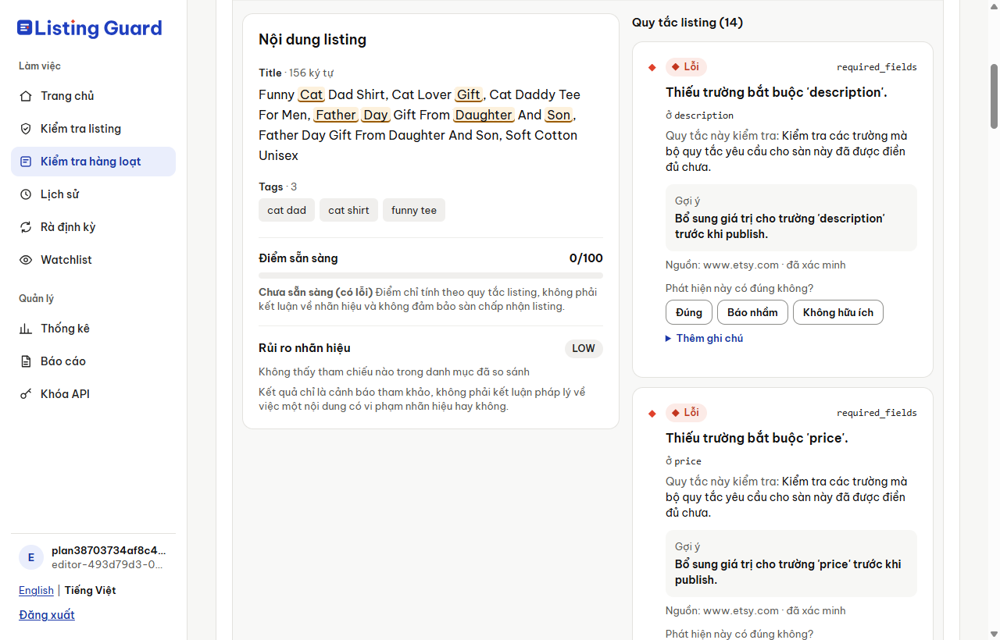
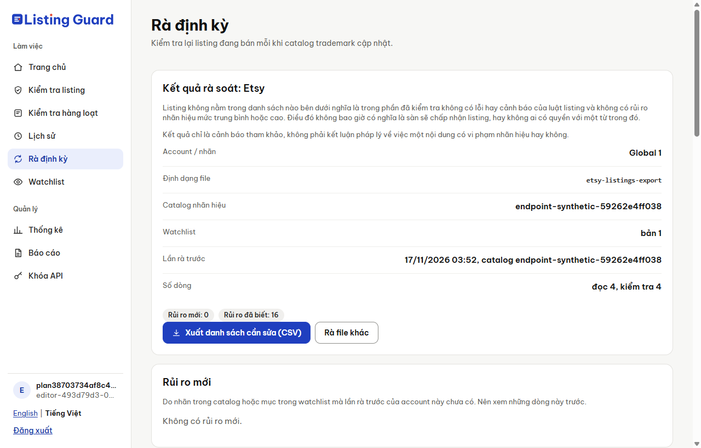
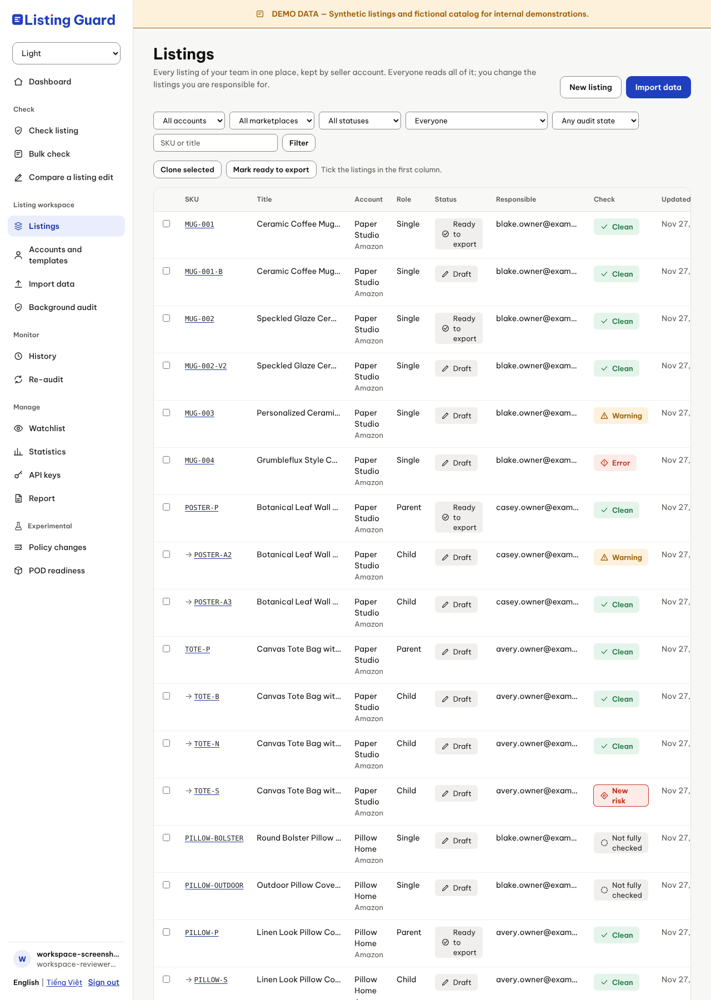
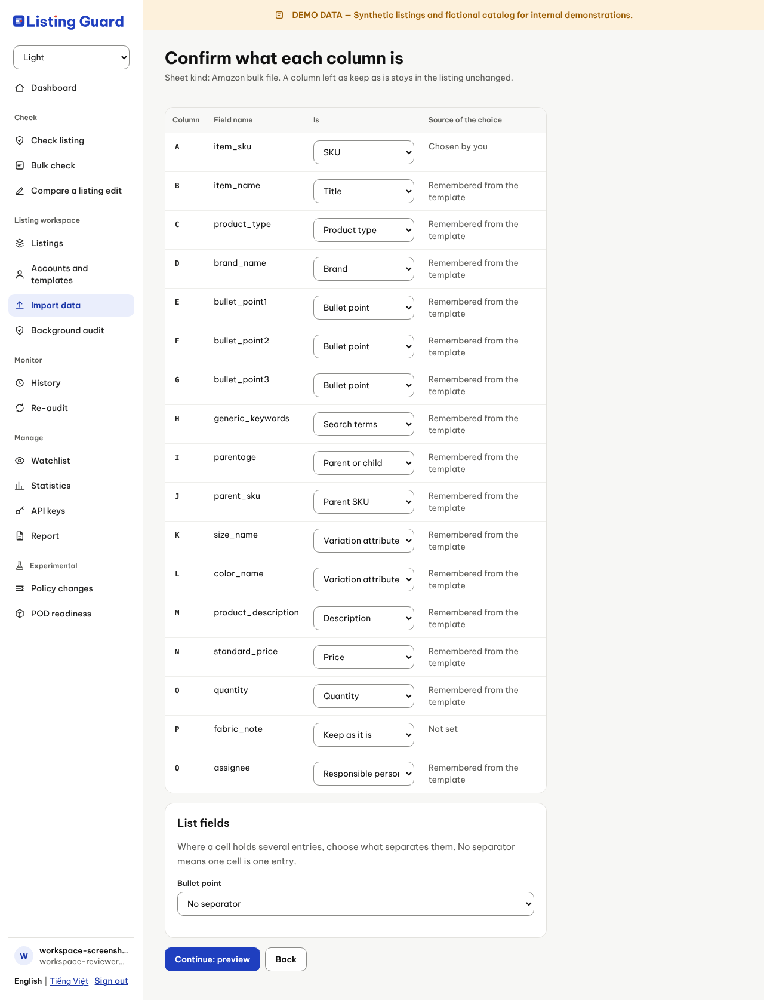
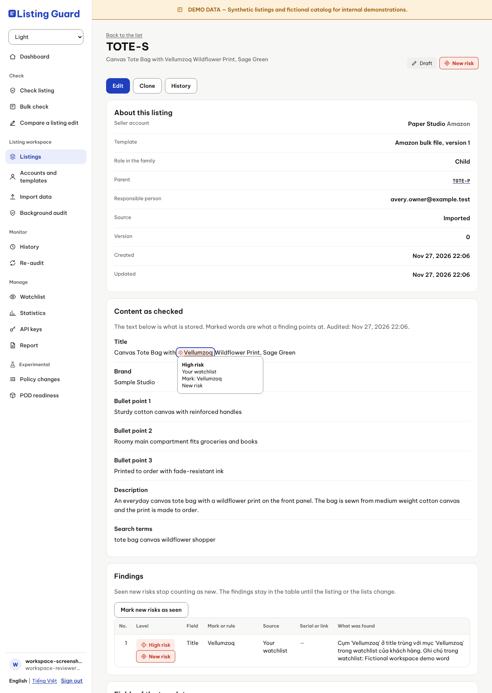
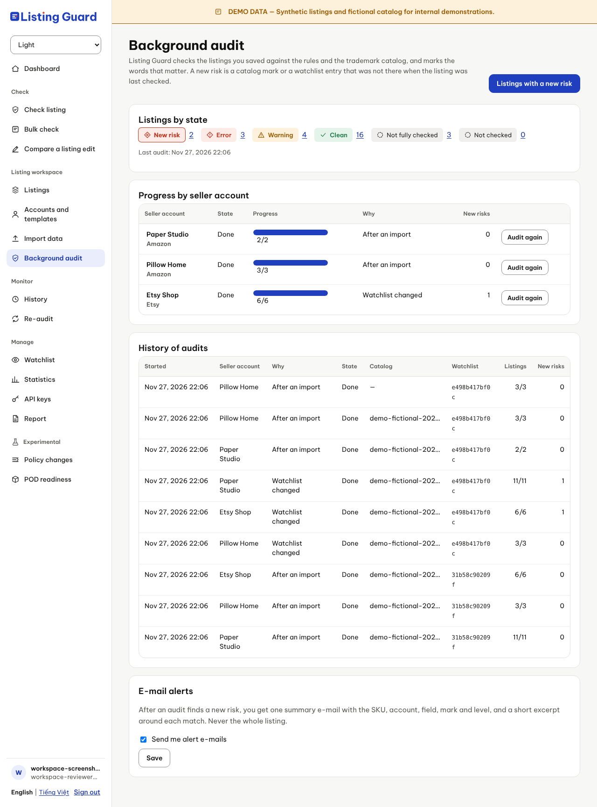

<h1>
  <picture>
    <source media="(prefers-color-scheme: dark)" srcset="docs/design/logo/lockup-horizontal-reverse.svg">
    
  </picture>
</h1>

Input format adapters: [docs/adapters.md](docs/adapters.md)

[Official agent skill](docs/agent-skill.md)

[](https://github.com/thanhdatpb/Listing-Guard/actions/workflows/ci.yml)
[](https://github.com/thanhdatpb/Listing-Guard/releases/latest)
[](LICENSE)
[](https://github.com/thanhdatpb/Listing-Guard/pkgs/container/listing-guard)

Self-hosted pre-publish compliance API for Etsy and Amazon listings: deterministic rules, explainable trademark risk, built for sellers, tools and AI agents.

**Latest release notes: [v0.11.0](docs/releases/v0.11.0.md)**. The latest published tag remains v0.10.0 until
v0.11.0 is tagged and the release workflows finish. The target image is `ghcr.io/thanhdatpb/listing-guard:0.11.0`
for `linux/amd64` and `linux/arm64`. Deploy by version tag.



The API checks listings and returns findings with their source, field and evidence. Separate endpoints screen variation families, buyer personalization text and listing images.
Sellers can compare edits and reopen saved check results in the [console history](docs/edit-mode.md).
An optional, off-by-default console button proposes rewrites that only appear after the rules and the trademark check accept them ([LLM suggestions](docs/llm.md)); with `max-rounds` above 1 it asks the model again, with the reasons the checks gave ([ADR-050](docs/adr/ADR-050-rewrite-repair-rounds.md)).
The API stores results in each client's scope; optional plans, quota and fix/readiness output are disabled by default.
Trademark checks require an operator loaded catalog, and image checks are disabled by default with thresholds still unverified.
The optional console keeps magic-link sign-in by default and can use verified Cloudflare Access identities without SMTP (ADR-027).
Listing Guard suggests and reports. It never edits or publishes a listing and does no SEO.

Optional [phrase screening](docs/phrase-screening.md) batches up to 2,000 seller keywords or print-text phrases with catalog and watchlist evidence.
Optional [listing workspace](docs/workspace.md) (off by default, ADR-059) keeps listings per seller account, with templates in versions and imports from Excel, Google Sheets, TSV or pasted cells.

The pilot console includes a keyword CSV and print-text screening workflow with session-scoped exports ([guide](docs/pilot-seller-guide.md)).

- [Demo workspace on Docker Desktop](docs/demo.md)

## What it checks

State of v0.11.0. "Ready" means it works and its tests pass, within the evidence status of the last column; this release still needs its Oracle A1 and Cloudflare deployment smoke test.

| Endpoint or capability | What it does | Availability | Evidence status |
|---|---|---|---|
| `POST /api/v1/checks` | Deterministic Etsy and Amazon listing rules | Ready | Each rule carries `verified`, `secondary` or `unverified` sourcing; Amazon rules are WARNING only |
| `POST /api/v1/listing-edits` | Compares a listing before and after a revision: changed fields, new, changed and remaining findings ([guide](docs/edit-mode.md)) | Ready | Runs the listing, trademark and optional variation packs, so their evidence status applies; comparison text is not stored |
| `POST /api/v1/trademark-checks` | Explainable mark matches against the configured versioned catalog | Needs a `READY` catalog (`503` otherwise, `200 INCOMPLETE` for a client with a watchlist entry) | Reference warning, not a legal conclusion; trademark rules and product classes are unverified; the false-positive rate on the real catalog is not measured |
| `GET`/`PUT /api/v1/trademark-watchlist` | A client's own list of marks (team names, nicknames, slogans), scanned by every trademark check; works with no catalog ([guide](docs/watchlist.md)) | Ready | The client's own data; findings are marked `WATCHLIST`, `INCOMPLETE` without a catalog |
| `POST /api/v1/variation-checks` | Checks parent/child variation structure, combinations and SKUs | Ready as hints | No rule is verified; findings are WARNING or INFO, never ERROR |
| `POST /api/v1/personalization-screenings` | Screens buyer-entered text against a print profile and the trademark catalog | Runs, but **placeholder profiles** | The shipped print profiles and personalization rules use invented values; text is personal data and is not stored or repeated |
| `POST /api/v1/image-checks` | Checks image properties for Etsy or Amazon | Off by default | Shipped marketplace thresholds are unset; results are INCOMPLETE; images are not recognized for marks, logos or text; not safe for an untrusted caller |
| `POST /api/v1/feedback`, `GET /api/v1/feedback/stats` | Records a verdict on a finding and reads the counts ([guide](docs/feedback.md)) | Ready | What reviewers reported, not a measured precision; no listing text is stored |
| `GET /api/v1/rulesets/{marketplace}/limits`, `GET /api/v1/capabilities`, `GET /api/v1/input-adapters`, `GET /api/v1/usage`, `GET /api/v1/reports/summary` | Reads limits, deployment capabilities, input formats, plan and usage, and stored-result counts | Ready | Read-only; reports do not read listing text; the Shopify input format is experimental |
| `POST /api/v1/policy-checks`, `GET /api/v1/policy-checks/{id}` and AI Workbench | Etsy policy analysis with code-verified citations | **Experimental, off by default** | Scripted providers and offline fixtures tested. Real-provider evaluation and approved retention are pending. |
| ReviewCase API and Review Queue | Tenant-scoped review, explicit writer grants and audit | **Experimental, off by default** | Console access also requires the Console flag. |
| Verified cases | Curated cases and tenant-scoped similar-case search | **Experimental, off by default** | Requires Review Queue and reviewer grant. |
| Policy impact | Proposed reports from approved snapshots and manual re-audit | **Console-dependent, experimental** | The Console is off by default. Reports require operator-supplied snapshots. |
| POD Readiness | Versioned profiles, supplier CSV import and independent marketplace, trademark and production results | **Console-dependent, experimental** | Disabled in the pilot sample. Shipped manufacturer limits are unverified. |

| Beyond the endpoints | Availability | Evidence status |
|---|---|---|
| Console (check, bulk check, history, re-audit, watchlist, statistics, report, API keys; Vietnamese and English) | Optional, off by default | Integration tests and a look at screenshots; not tried with a real SMTP server or Cloudflare Access team; the Vietnamese copy needs a native reader |
| [Seller pilot and onboarding](docs/pilot-setup-checklist.md) | Opt-in Cloudflare Access Console with Vietnamese by default | Readiness page, account import and weekly reporting. The real owner-based catalog gate is pending. |
| [Bulk Sheet content scope](docs/bulk-check.md) | Defaults to content in pilot and full elsewhere | Missing Sheet columns are listed as unchecked. Single listing and API checks still use full scope. |
| [Owner-based catalog](docs/catalog-activation-runbook.md) | Optional catalog rebuild and activation | Parquet schema verified. The threshold, owner-name matching and 47 probes on the real catalog have yet to be measured or validated. |
| [Periodic re-audit](docs/reaudit.md) | Ready in the console | The first run of a scope has nothing to compare with |
| [Listing workspace (ADR-059)](docs/workspace.md) | Optional, off by default | Imports and mappings use synthetic workbooks. Real Amazon templates are unverified. Export by account template is pending. |
| [Workspace editor and cloning (ADR-062)](docs/workspace.md#11-trình-soạn-tạo-mới-nhân-bản-adr-062) | Optional, off by default | Editor, new listing, clone, history, "ready to export" gate and import conflicts, tested on synthetic files and PostgreSQL 16 without pgvector. Not run in a browser; column pairing between two real Amazon templates is unverified. |
| [Background audit, inline highlights and e-mail alerts (ADR-061)](docs/workspace.md#9-rà-nền-tô-đỏ-và-email-adr-061) | Optional, off by default | No performance measurements on PostgreSQL with the real trademark catalog. E-mail has not been tried with a real SMTP server. |
| [LLM judge and rewrite suggestions](docs/llm.md) | **Off by default**; free tiers | Not measured on real claims; a verified suggestion is not legal clearance |
| `hf-convert`, `trademark-import`, `batch-check`, `backtest`, `policy-diff` | Ready as jobs | `hf-convert` ran on one build of the dataset; `backtest` has not been run on a real labelled file |
| `uspto-convert`, `uspto-sync`, `tsdr-status` | Offline modes only | Unverified against real USPTO data; the downloads are off and unverified |
| MCP server (nine read-only tools) and Java SDK | Ready | The MCP HTTP transport has no authentication |

Rule sources stay labeled as they are in the rulesets; no unverified limit is presented as official. The trademark result includes its disclaimer and is not legal advice. The image checker does not identify logos, text or marks. A missing finding is not marketplace approval.

Optional trademark calibration groups lowered common-word matches and preserves their evidence. [Setup and rollback](docs/trademark-catalog.md#bật-hiệu-chỉnh-trademark-theo-tier)

## How a check flows


1. A client sends `POST /api/v1/checks` with `X-API-Key`.
2. Cloudflare terminates HTTPS and the Cloudflare Tunnel forwards the request to the Oracle A1 Docker Compose deployment (Cloudflare Access protects only `/console/*` and `/health`; `/api/v1/*` is protected by the API key and the rate limit).
3. The API validates the client's API key and applies per-client rate limiting and optional plan/quota checks.
4. The cache identity includes the client, marketplace, pack, input hash, ruleset version and `analysisVersion`.
5. On a cache miss, the API runs the requested pack using its declared ruleset and analysis version.
6. The result and findings are stored under the authenticated client in PostgreSQL; only hashes and bounded evidence are stored for retained sensitive packs.
7. The API returns the findings and evidence, with the ruleset and analysis versions and any applicable disclaimer.

## Giao diện

The console is the page a seller or a lead works in: English by default (set `LISTING_GUARD_CONSOLE_DEFAULT_LOCALE=vi` for a Vietnamese deployment) with a switch, light and dark, built on one set of
design tokens ([ADR-040](docs/adr/ADR-040-console-visual-identity-and-design-system.md),
[ADR-041](docs/adr/ADR-041-console-work-pages.md), [ADR-042](docs/adr/ADR-042-console-manage-pages.md)). Screenshots use invented listings.

**Home.** What the checks held back this week, what needs attention, and the data the checks ran on.

<picture>
  <source media="(prefers-color-scheme: dark)" srcset="docs/images/console/home-week-dark.png">
  
</picture>

**Bulk check.** Paste rows from a Sheet or upload a file; every row has its SKU, a shortened title, a status and its main finding.

<picture>
  <source media="(prefers-color-scheme: dark)" srcset="docs/images/console/bulk-result-dark.png">
  
</picture>

**A row opened.** The listing as it was checked, with the words a finding points at marked, and a card for each finding with its rule, evidence, suggestion and source.

<picture>
  <source media="(prefers-color-scheme: dark)" srcset="docs/images/console/bulk-detail-dark.png">
  
</picture>

**Periodic re-audit.** Upload the file of the listings on sale again each time the trademark catalog changes; new risks come before the known ones.

<picture>
  <source media="(prefers-color-scheme: dark)" srcset="docs/images/console/reaudit-result-dark.png">
  
</picture>

### Listing workspace

The screens use fictional listing and trademark data.

**Listing workspace.** Filter stored listings by seller account, marketplace, owner, listing status or audit status.

<!-- Generate with ./mvnw -B -pl api -am -Dtest=WorkspaceBrowserIntegrationTest -Dsurefire.failIfNoSpecifiedTests=false test after setting the variables in docs/workspace.md.
<picture>
  <source media="(prefers-color-scheme: dark)" srcset="docs/images/console/workspace-list-dark.png">
  
</picture>
-->

**Map the columns.** Confirm which workbook columns hold the SKU, title, description and other listing fields before previewing the import.

<!-- Generate with ./mvnw -B -pl api -am -Dtest=WorkspaceBrowserIntegrationTest -Dsurefire.failIfNoSpecifiedTests=false test after setting the variables in docs/workspace.md.
<picture>
  <source media="(prefers-color-scheme: dark)" srcset="docs/images/console/workspace-mapping-dark.png">
  
</picture>
-->

**Open a listing.** The audited content marks the matching words, and the focused tooltip and findings table explain why they were flagged.

<!-- Generate with ./mvnw -B -pl api -am -Dtest=WorkspaceBrowserIntegrationTest -Dsurefire.failIfNoSpecifiedTests=false test after setting the variables in docs/workspace.md.
<picture>
  <source media="(prefers-color-scheme: dark)" srcset="docs/images/console/workspace-detail-dark.png">
  
</picture>
-->

**Background audit.** Follow progress by seller account, see why each audit ran and choose whether to receive e-mail alerts.

<!-- Generate with ./mvnw -B -pl api -am -Dtest=WorkspaceBrowserIntegrationTest -Dsurefire.failIfNoSpecifiedTests=false test after setting the variables in docs/workspace.md.
<picture>
  <source media="(prefers-color-scheme: dark)" srcset="docs/images/console/workspace-audit-dark.png">
  
</picture>
-->

See the [workspace guide](docs/workspace.md) for the sheet confirmation and import preview.

History, the watchlist, statistics, the report and API keys are on the same system: [the project guide](docs/overview.md) says what each page does.

## Use it from AI agents


Build the MCP jar and configure a client key and API URL. STDIO is the default transport; its HTTP transport has no authentication and must stay on loopback or a private network.

```bash
./mvnw -B -pl mcp-server -am package
export LISTING_GUARD_MCP_API_KEY='<client-key>'
export LISTING_GUARD_MCP_BASE_URL='https://listing-api.example.com'
java -jar mcp-server/target/listing-guard-mcp.jar
```

The nine tools are `check_listing`, `check_trademark`, `check_variations`, `check_listing_edit`, `screen_personalization`, `get_limits`, `get_usage`, `get_capabilities` and `get_watchlist`. Listing access is read-only: check calls can store API results and may use quota, but no tool edits or publishes a listing. Successful API responses are passed through unchanged; the model does not decide what a finding means. See the [MCP guide](docs/mcp.md).

## Ecosystem

- [REST API](docs/integration-guide.md) for marketplace integrations and seller tools.
- [Chrome extension](https://github.com/thanhdatpb/Listing-Guard-extension) for Etsy editor checks and manual Etsy/Amazon input.
- [MCP server](docs/mcp.md) for Claude Code, Claude Desktop and other MCP clients.
- [Java client SDK](client/README.md) for Java backends.
- [`batch-check`](docs/batch-check.md) for CSV or Amazon flat-file reports.
- [Console bulk check](docs/bulk-check.md) to paste rows from a Google Sheet (or upload a CSV) and copy the results back; a content scope checks only the columns the Sheet has, so a Sheet without a category column is not all red ([ADR-052](docs/adr/ADR-052-content-scope-for-sheet-checks.md)).
- [Seller pilot guide](docs/pilot-seller-guide.md) for the Vietnamese Sheet-to-recheck workflow and pilot reports, and the [pilot setup checklist](docs/pilot-setup-checklist.md) for the lead: `account import`, a watchlist template and the readiness page ([ADR-053](docs/adr/ADR-053-pilot-onboarding-kit.md)).
- [Periodic re-audit](docs/reaudit.md): upload the listings you have on sale and see which trademark risks are new since your last audit, which listings changed, and a CSV of what to fix ([ADR-035](docs/adr/ADR-035-periodic-reaudit.md)).
- [Free-tier LLM providers and a trademark context judge](docs/llm.md) (off by default): Groq, Cloudflare Workers AI and Gemini, so a colour name such as "Dodger blue" is shown as a likely descriptive word instead of a brand; the rules stay in charge ([ADR-036](docs/adr/ADR-036-free-tier-llm-providers-and-trademark-context-judge.md)).
- [Finding feedback and the weekly home page](docs/feedback.md): mark each finding Correct, False positive or Not useful, and show the week's value and false-positive rates ([ADR-034](docs/adr/ADR-034-finding-feedback-and-value-dashboard.md)).
- [`backtest`](docs/backtest.md) to measure the checks on past claims and takedowns, with a one-page summary for a manager; a labelled sample set gates rule precision in CI ([ADR-032](docs/adr/ADR-032-value-backtest-and-labeled-evaluation.md)).
- The optional web console speaks English and Vietnamese (`LISTING_GUARD_CONSOLE_DEFAULT_LOCALE`, [ADR-028](docs/adr/ADR-028-console-localization.md)) and follows the Listing Guard visual identity in light and dark ([ADR-040](docs/adr/ADR-040-console-visual-identity-and-design-system.md), [design pack](docs/design/README.md)); the API does not change.

## Quickstart with Docker

Requirements: Java 21 for the build, Docker for PostgreSQL and the API. The API starts without a model or external API key.

```bash
docker compose up --build -d
docker compose run --rm admin client create demo-client
docker compose run --rm admin key create demo-client --label="first key" # copy the one-time key
curl -X POST http://localhost:8080/api/v1/checks -H 'X-API-Key: <client-key>' -H 'Content-Type: application/json' -d '{"marketplace":"ETSY","listing":{"title":"Handmade Mug","description":"A ceramic mug.","tags":["mug","Mug","gift_idea"],"price":{"amount":1999,"divisor":100,"currency_code":"USD"},"taxonomy_path":["Home & Living","Mugs"]}}'
curl -X POST http://localhost:8080/api/v1/trademark-checks -H 'X-API-Key: <client-key>' -H 'Content-Type: application/json' -d '{"marketplace":"ETSY","listing":{"title":"Handmade Mug","description":"A ceramic mug.","tags":["mug","Mug","gift_idea"],"price":{"amount":1999,"divisor":100,"currency_code":"USD"},"taxonomy_path":["Home & Living","Mugs"]}}'
```

The second request needs an operator configured catalog; without one it returns `503 trademark-not-configured`. Without a USPTO key, `hf-convert` builds a real catalog file from the public Hugging Face rebuild of the USPTO data, for `trademark-import` to load ([steps](docs/trademark-catalog.md#hugging-face-source-hf-convert), [ADR-030](docs/adr/ADR-030-hugging-face-uspto-parquet-source.md)). See the [integration guide](docs/integration-guide.md) for request formats, error handling and API key management.

## Deploy

See [Oracle A1 behind Cloudflare Tunnel](docs/deploy-oracle.md) for production setup, Access, backups, upgrades and health checks. General production settings are in [deployment](docs/deployment.md). Before the first deployment read [deploy readiness](docs/deploy-readiness.md): what is on or off by default, the environment variables, the resource budget, a security checklist, a smoke test and the manual steps in order. The release notes of the version to deploy are in [docs/releases](docs/releases/v0.11.0.md).

## Roadmap

- Decide a generic and short word policy for a real catalog: on the Hugging Face catalog all 20 sample listings came back `HIGH` ([measurement](docs/deploy-readiness.md#the-catalog-measured-on-the-real-hugging-face-build)), then run `backtest` on a labelled file.
- Run the smoke test on the Oracle A1 (ARM64 hardware) and measure a trademark check there.
- Verify the USPTO conversion and run the trademark evaluation on real data ([ADR-009](docs/adr/ADR-009-trademark-risk-scanner.md)).
- Verify the TSDR status check against the real TSDR once a key exists, and decide how its dead-mark report feeds the next catalog sync ([ADR-009](docs/adr/ADR-009-trademark-risk-scanner.md#tsdr-status-check-job-tsdr-status)).
- Review official image thresholds and build bounded image decoding and upload staging ([ADR-008](docs/adr/ADR-008-image-compliance-checker.md)).
- Evaluate retrieval, then implement the optional policy analyzer and real LLM adapter ([ADR-011](docs/adr/ADR-011-policy-grounded-analyzer.md)).
- Continue contract compatibility and Java SDK evolution ([ADR-022](docs/adr/ADR-022-api-contract-and-compatibility.md), [ADR-023](docs/adr/ADR-023-java-client-sdk.md)).
- Review variation sources and real workshop print profiles ([ADR-015](docs/adr/ADR-015-variation-checks.md), [ADR-016](docs/adr/ADR-016-personalization-screening.md)).
- Verify listing workspace templates against real Amazon templates (.xlsm/.txt); editor, cloning and export by account template.

See the [detailed status and project guide](docs/overview.md) for implemented behavior and remaining work.

## Documentation

- [Detailed project guide](docs/overview.md)
- [Rulesets and sourcing](docs/rulesets.md)
- [Trademark catalog and USPTO data](docs/trademark-catalog.md)
- [Policy corpus and retrieval](docs/policy-corpus.md)
- [Policy change monitor](docs/policy-monitor.md)
- [Input schema](docs/input-schema.md)
- [Listing health report and batch check](docs/batch-check.md)
- [Listing workspace](docs/workspace.md)
- [MCP server](docs/mcp.md)
- [Integration guide](docs/integration-guide.md)
- [Deployment](docs/deployment.md)
- [Oracle A1 deployment](docs/deploy-oracle.md)
- [Deploy readiness](docs/deploy-readiness.md)
- [Architecture decisions](docs/adr/)
- [Release notes](docs/releases/v0.11.0.md)

## License

MIT © 2026 Thanh Dat Tran. See [LICENSE](LICENSE).
