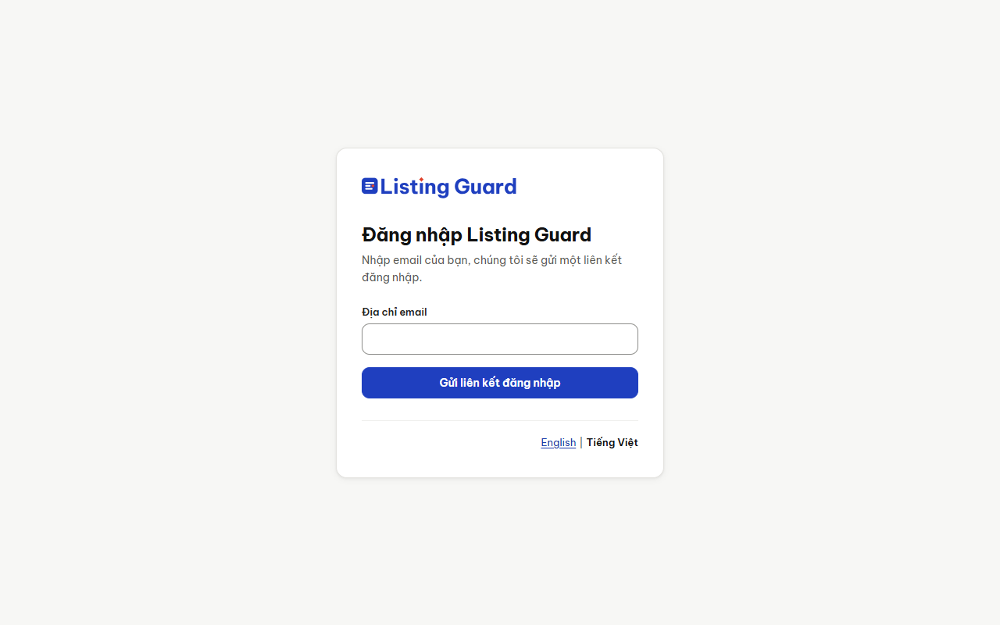
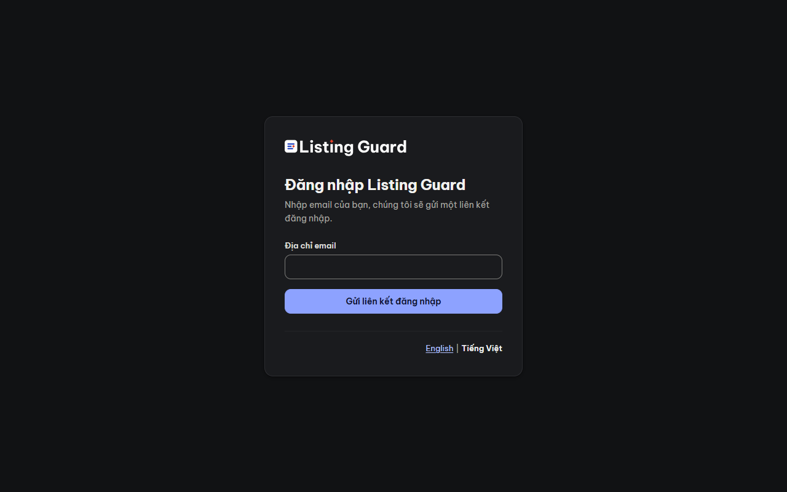
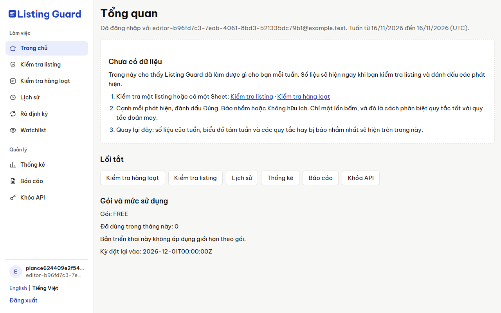
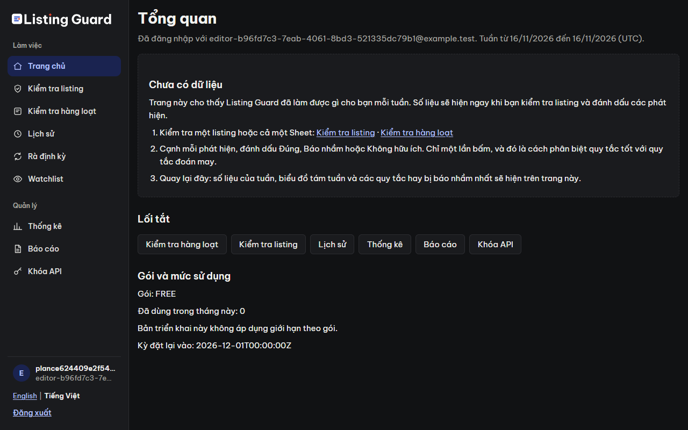

# ADR-040: Console visual identity and design system

- Status: Proposed
- Date: 2026-11-16
- Depends on: [ADR-014](ADR-014-listing-workspace.md) (the console and its editor), [ADR-027](ADR-027-console-access-login.md) (the
  sign-in pages are public), [ADR-028](ADR-028-console-localization.md) (no sentence in a template or a script),
  [ADR-034](ADR-034-finding-feedback-and-value-dashboard.md) (static files, the vendored htmx, `ConsoleVendorResources`)
- Source: the design pack in [docs/design/](../design/README.md) (Listing Guard Design System v2, 2026-11-15)
- Acceptance convention: Keep Proposed until the PR implementing this ADR is approved and merged. Then set Status to
  Accepted and Date to the merge date.

## Context

The console is about to be used every day by HappyC sellers and their managers. Until now each page carried its own CSS, the
menu was a row of links, and nothing said whose product it was. The brand work is done and committed in `docs/design/`: the
wordmark "Listing Guard" in cobalt with a red diamond, a symbol of three listing lines, the typeface Be Vietnam Pro, and tokens for
light and dark. This ADR puts that pack into the product in a way that lasts: one source for every color, space and radius, one
base style sheet, one page shell, and a rule for adding to them. It does not rewrite the pages; they move one at a time later.

The brief for the look: professional, friendly to a seller, and not like something generated: no gradient, no emoji, no card
with a colored edge on one side, and red only for a problem.

## Decision

### 1. `docs/design/` is the source; the tokens are the only source of color, space and shape

`docs/design/tokens.json` is the one source of the tokens; `docs/design/tokens.css` is generated from it (by the design tool, never by
hand). Colors for light and dark, the type scale (`.t-display`, `.t-title`, `.t-heading`, `.t-body`, `.t-body-strong`, `.t-caption`,
`.t-code`), spacing (`--space-1` to `--space-8`), radii (`--radius-sm`, `-md`, `-lg`, `-full`), the card shadow and the font stacks are
variables there and nowhere else. No console style sheet writes a color code of its own (hex, `rgb()`, `hsl()`) or a font family; it
reads `var(--...)`. A shade the tokens do not name (a hover ground, a line, a muted-but-darker ink) is derived in `app.css` from tokens
with `color-mix(in srgb, ...)`, named, and checked for contrast (see 6). `app.css` may add such shades and never redefine a token (a test
holds both).

Red has two jobs and no others: `--danger` is the text, icon and border of a problem that must be fixed, and `--accent` is the
diamond mark of a problem (the logo's dot, the mark on a result line). `--accent` never colors small text (it does not reach 4.5:1 on
white). Trademark risk and warnings are `--warning`; a clean listing is `--success`. A state is always a word and a shape, never a
color alone.

### 2. Self-hosted, public files under `/brand/`

The fonts, the logos, the icons and `tokens.css` are files of the product, served by the application itself from
`api/src/main/resources/static/brand/`: `tokens.css`, `fonts/*.woff2` and the SIL OFL license, `logo/*.svg` (lockup, wordmark,
symbol, each with a reverse), `favicon.ico`, `icons/icon-*.png`. Nothing is loaded from a CDN or from Google Fonts. The font paths in
`tokens.css` are relative (`fonts/...`), so they stay correct under any context path.

`/brand/**` is public: the sign-in page needs it before anyone is signed in, and it holds no data of a client. `ApiKeyFilter` lets it
through (the API chain otherwise wants a key) and no console rule applies, because it is outside `/console/**`. The base style sheet
lives in `static/console/app.css` with the other console sheets but is **served at `/brand/app.css`** (`BrandResources` maps it), for two
reasons: the sign-in pages need it before anyone is signed in, and Cloudflare Access (ADR-027) fronts only `/console/*`, so a sheet under
`/console/` would be redirected to the Access login in an Access-only deployment and the sign-in page would have no style. Every file
under `/console/` (`editor.css`, `console.css`, the scripts, `/console/vendor/**`, and `app.css` at its own path) stays behind the sign-in, as
before. A test holds both sides.

Caching: `/brand/**` (the style sheet included) is sent with `Cache-Control: public, max-age=31536000, immutable`
(`BrandResources`). That is safe because a page writes every one of these addresses with `?v=<hash>`, where the hash
(`BrandAssets`, twelve hexadecimal characters of a SHA-256 over the brand files and `app.css`, computed at start-up) changes whenever any
file changes. The one exception is a font, which `tokens.css` names without a version: **a font file is never replaced under the same
name** (a new cut gets a new name). `X-Content-Type-Options: nosniff` comes from Spring Security's default headers and is unchanged.

### 3. Dark follows the system

Dark is `@media (prefers-color-scheme: dark)` in `tokens.css`, nothing else: no toggle, no cookie, no stored preference, no script.
The logo has a cobalt file and a reverse file and a page chooses with `<picture>` and the same media query; the `theme-color` meta has one
value per scheme. A user who wants the other scheme changes the system setting. A toggle is a later decision, not forbidden.

### 4. `app.css` and the page shell

`static/console/app.css` (served at `/brand/app.css`) is the one base sheet. It holds a light reset, the base type (`body` is Be Vietnam Pro 15/24), links and a
focus ring that is visible on every control in both schemes, then the components below, then the shell. Class names: components are
**`lg-`** (BEM: `lg-card`, `lg-card__head`, `lg-btn--primary`) and the shell is **`app-`**, so neither can meet the names the existing page sheets
use (`.card`, `.bar`, `.field`, `.tabs`, `.button`...). The load order on a console page is `/brand/tokens.css`, `app.css`, then the
page's own older sheet.

Components that exist: buttons (`lg-btn`; `--primary` cobalt, the default outlined, `--small`, `--icon` which must carry an
`aria-label`, `--link`, `--block`), cards (`lg-card`, `--raised` with the shadow, only for a card that floats on the page ground; a
`lg-stat` figure), status pills (`lg-pill--error`, `--trademark`, `--clean`, `--brand`, and the plain `lg-pill` for a count; the shape is
drawn in CSS), the red diamond (`lg-mark`) and the text highlight (`lg-highlight`), tables (`lg-table-wrap` that scrolls sideways on a
narrow screen, `lg-table` with head, row, hover and selected row), form controls (`lg-field`, `lg-input`, `lg-select`, `lg-textarea` and
`--mono`, with the invalid state), segmented tabs (`lg-seg`), chips (`lg-chip`), banners (`lg-banner--info`, `--warning`, `--sticky`), the file
drop (`lg-drop`), the progress bar (a native `<progress class="lg-progress">`), the toggle (`lg-toggle`), the empty state (`lg-empty`), the
page header (`lg-page`, `lg-page__head`), layout helpers (`lg-grid`, `lg-stack`, `lg-actions`) and the sign-in card (`lg-auth`).

The shell, in `templates/console/layout.html` (fragment names kept, so no page changes for them): `head` (icons, `theme-color`,
tokens, `app.css`), `logo(cssClass)`, `demoBanner`, `languageSwitch`, `htmx` and `nav(active)`. The sidebar is 240 px: the lockup, the
group "Work" (Home, Check, Bulk check, History, Re-audit, Watchlist), the group "Manage" (Statistics, Report, API keys), the current page on
`--brand-subtle`, and at the foot the signed-in e-mail and client (`ConsoleAccountAdvice`), the language links and sign out. Icons are
one set of 24-unit strokes drawn once as an inline SVG sprite and used with `<use>`; they are decorative, the words are the links. Below
860 px the sidebar is a bar on top and the menu opens with a checkbox and its label: no script, and it works with the keyboard (Tab, Space).
A skip link ("Skip to content") is the first control of every signed-in page and goes to `#main`, an anchor placed at the start of each
page's `<main>`. The demo-catalog banner keeps its place, text, role and behavior (sticky, every page, sign-in pages included) and
takes its colors from the warning tokens.

### 5. How to add or change a component

A new page uses `layout.html` (`head`, `demoBanner`, `nav('<key>')`) and `app.css`, and adds **no color of its own**: if what it needs is
not in the list above, the component is added to `app.css` first, in the same pull request, in this order:

1. Use tokens only. If a shade is missing, derive it in the `:root` block of `app.css` from tokens, name it, and add each text and
   ground pair that uses it to `ConsoleContrastTest` (4.5:1 for text, 3:1 for the lines of a control).
2. Name it `lg-<thing>` with `__part` and `--variant`; write one rule per state (hover, focus is global, disabled, invalid).
3. Say in a short comment when to use it and what it needs from the markup (an `aria-label`, a native element).
4. Show a state with a word and a shape, never a color alone; use red only for a problem.
5. Text comes from message keys in both bundles (ADR-028).

A page sheet of its own may exist only for layout that is specific to the page, and writes colors with `var(--...)` only.

### 6. Accessibility

Every pair of text and ground that `app.css` puts together is at least 4.5:1 in light and in dark, and the line of an input or a toggle, the
focus ring and the diamond at least 3:1; `ConsoleContrastTest` resolves the tokens and the derived shades and fails a change that
breaks a pair. Focus is a 2 px cobalt ring on everything focusable. The shell has landmarks (`header`, `nav` with a label, `main`), a skip
link, links that say where they go, and `aria-current="page"` on the current page; icons are `aria-hidden`.

### 7. Keeping the copy in step with the pack

`static/brand/` is a copy of the pack, never edited by hand. When `tokens.json` changes: regenerate `docs/design/tokens.css` with the design tool,
run `scripts/sync-brand-assets.sh` (it copies `tokens.css`, the fonts, the logos and the icons into `static/brand/` and rewrites the first
line of `tokens.css`), and commit both. `BrandTokensInSyncTest` compares the two `tokens.css` files line by line (ignoring that first line and
the font paths), the fonts, logos and icons byte by byte, and the two `theme-color` values of the layout with the page ground of each
scheme; a pack that changed without the copy, or a copy edited by hand, fails the build. `ConsoleAppCssTest` scans `app.css` for color codes,
gradients, emoji, unknown variables, a redefined token and a one-sided border on a card.

### 8. The existing pages

Every console page now loads the tokens and `app.css` and sits in the new shell. Their own sheets stay for now (`editor.css`,
`console.css`, `bulk.css`, `rewrite.css`, `watchlist.css`) with the explicit conflicts fixed: the old color names (`--bg`, `--fg`, `--muted`,
`--line`, `--card`, `--error`, `--ok`, `--info`, `--mark`, `--accent-fg`) are aliases of tokens in `editor.css`; the old blue `--accent` was
renamed to `--brand` where it was read (the token `--accent` is red); the old top bar, the body font and the heading sizes are gone from
`editor.css` because `app.css` owns them. Pages are moved to the components one per pull request and their old rules deleted; when none
remains, the alias block goes. Until then a few old rules break the brief (the home page's cards with a colored top edge, for example) and are
listed in the pull request that introduced this ADR. [ADR-041](ADR-041-console-work-pages.md) moved the pages of daily work (home, Check
listing, bulk check, edit mode, rewrite suggestions, the feedback buttons): `rewrite.css` and the alias block are gone, `editor.css` and
`bulk.css` keep the layout of their page, and `console.css` is the sheet of the pages not moved yet.

## Consequences

- One look on every page, light and dark, with the brand's font, and a place for every new component.
- A pack update is one script and one test; it cannot silently drift.
- Fonts, logos and icons are served from our own origin and cached for a year, so the first view of a page costs about 100 KB of fonts and later views none.
- The sign-in pages need one public path, `/brand/**`, which holds only files of the product.
- `body:has(> .app-side)`, `color-mix()` and `<picture>` media sources need a current browser (Chrome 111, Firefox 121, Safari 16.4 or later).
  The console is an internal tool for staff, so this is accepted; an older browser shows the unstyled-but-working page.
- Old pages mix two ways of styling until they are moved.

## Alternatives considered

- **A CSS framework (Tailwind, Bootstrap) or a build step.** Rejected: the console has no Node build, a handful of pages, and a pack that
  already defines the tokens. Plain CSS keeps one tool chain (Maven) and one source.
- **Class names without a prefix (`.btn`, `.card`).** Rejected for now: they collide with classes of the pages not yet moved (`.card`,
  `.bar`, `.field`). The prefix can be dropped when the old sheets are gone, by one rename.
- **Hashed file names (`app-3fa9.css`) from Spring's resource chain** instead of `?v=`. Rejected: it rewrites CSS URLs and needs
  configuration whose behavior with `url()` in fonts is easy to get wrong; a hash in the query is explicit and testable.
- **A dark-mode switch.** Deferred: the system setting is enough for the first use, and a stored preference needs a decision about where.
- **Loading the font from Google Fonts** as the mockups do. Rejected: it sends each reader's address to a third party and fails offline.

## Open questions

1. Screenshots: `docs/images/console/` holds the sign-in page and the home page (the empty state: a new account has no data) in light and dark, taken
   with headless Chromium from the rendered pages served next to the real `/brand/` files. They are a view of the shell, not of a
   busy home page; replace the home pair when a deployment has data worth showing.
2. The Vietnamese copy of the new keys (group names, skip link) needs a native read, like the rest of ADR-028's Vietnamese.
3. When the last page is moved, drop the `lg-` prefix? Decide then.

## Results

Rendered and photographed (1280 px and 600 px, light and dark): the sign-in card matches `docs/design/screens/0-login`; every page keeps its content
inside the sidebar; the 860 px bar opens with the keyboard (Tab to the menu checkbox, Space); the skip link shows on the first Tab. Not measured:
Safari and Firefox (only Chromium was run), a screen reader, and any page other than the sign-in, home, bulk check and API keys pages.

