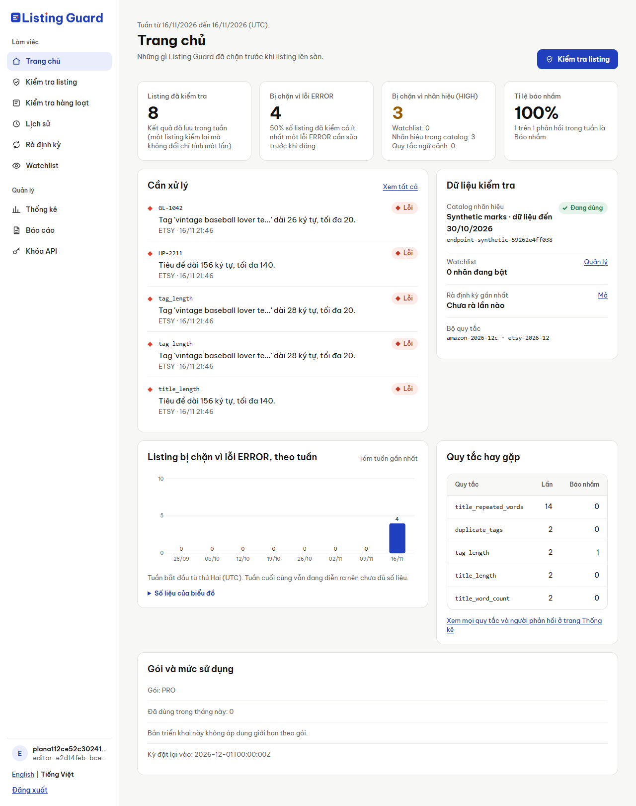
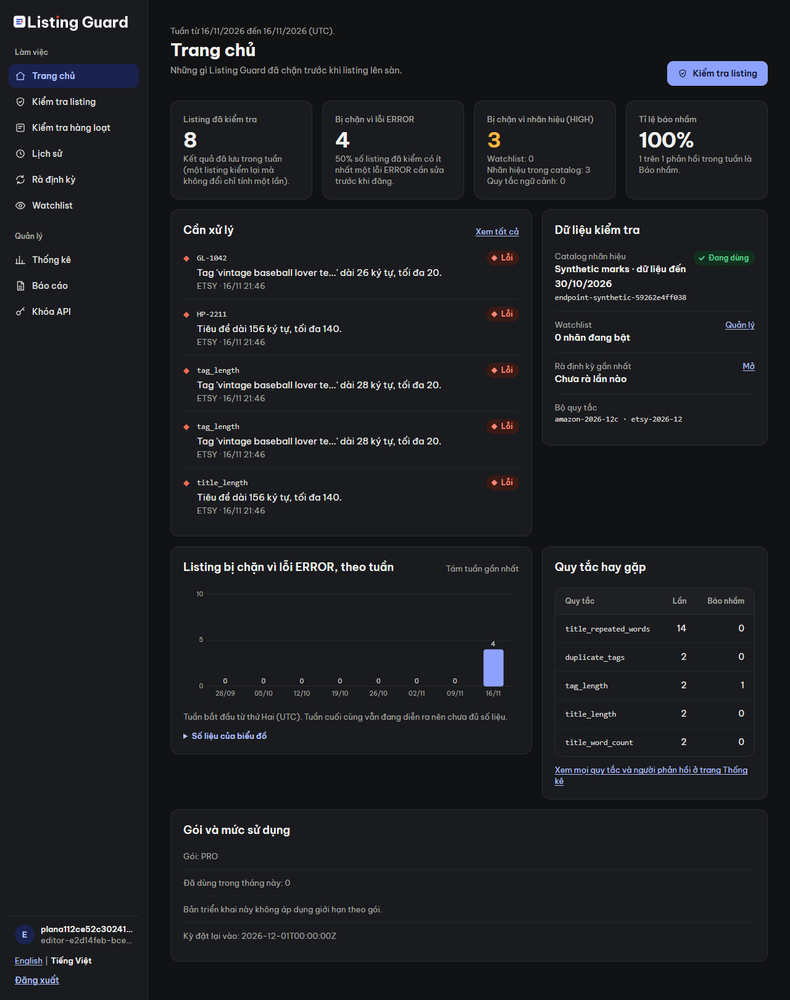
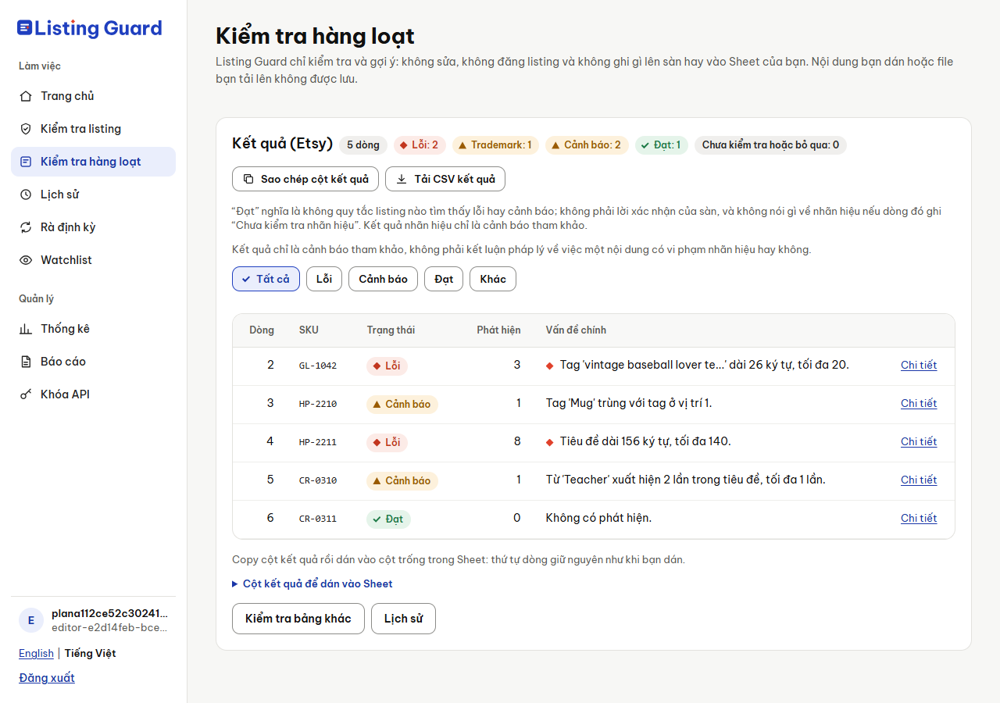
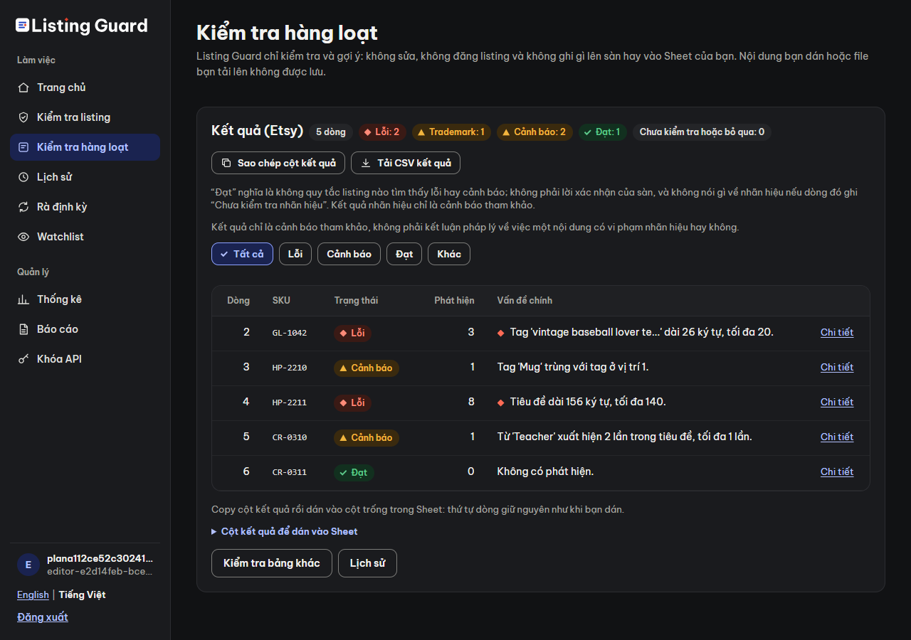
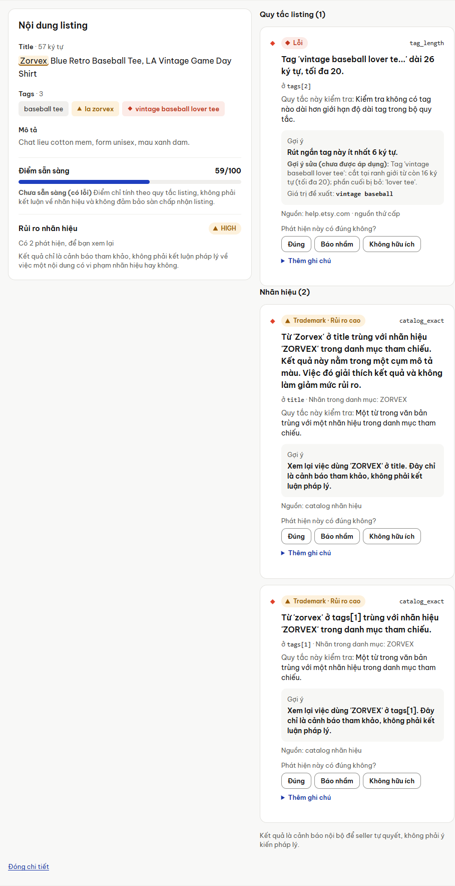
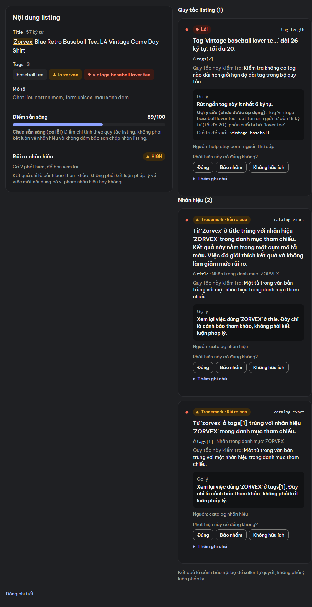
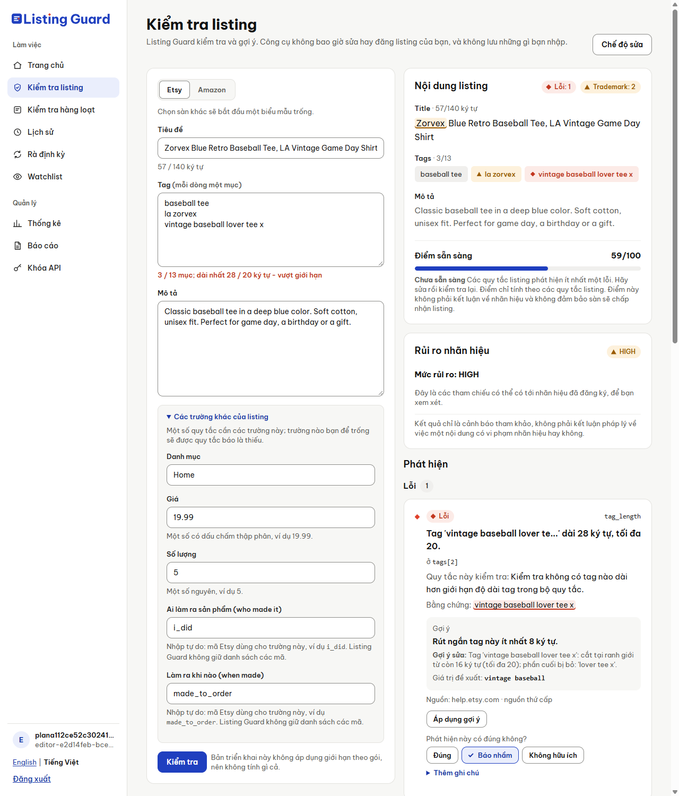
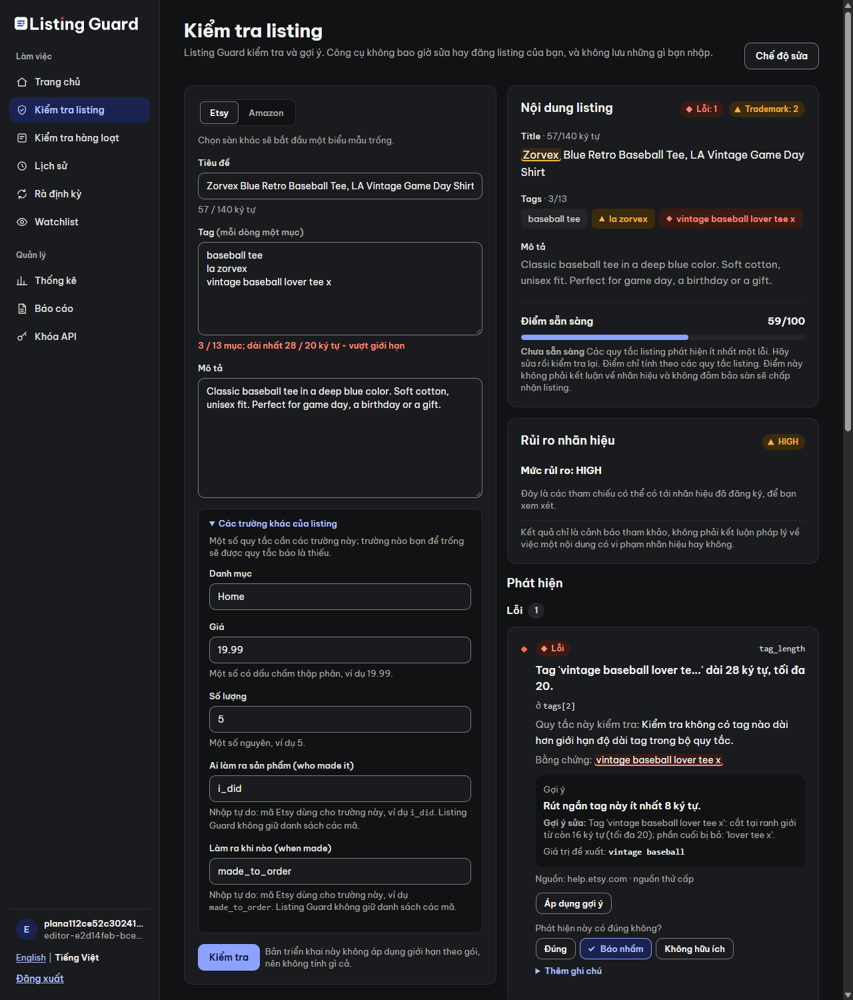
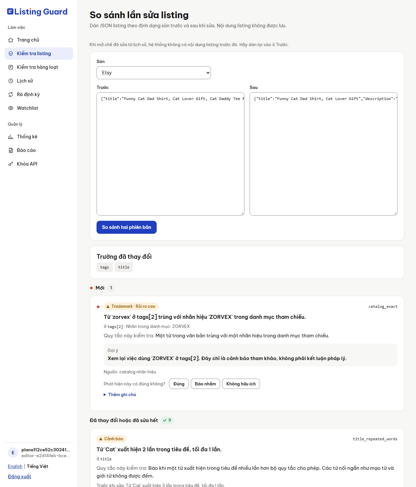
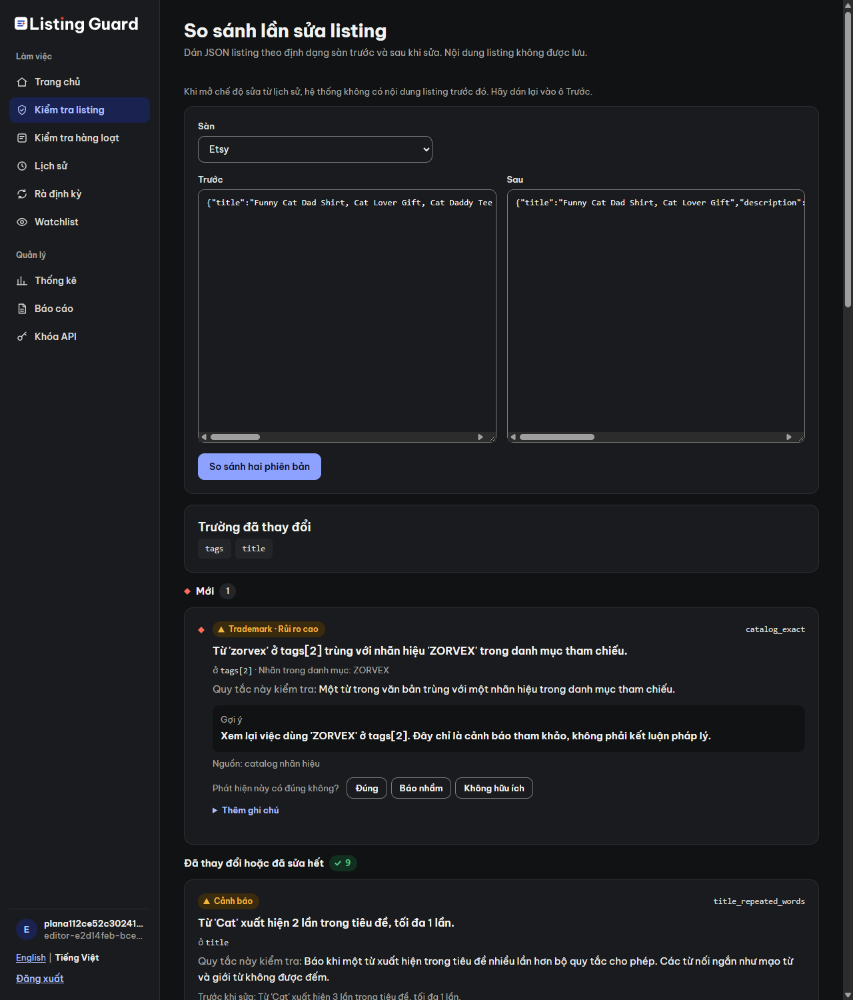

# ADR-041: The work pages on the design system

- Status: Proposed
- Date: 2026-11-16
- Depends on: [ADR-014](ADR-014-listing-workspace.md) (the editor), [ADR-028](ADR-028-console-localization.md) (no sentence in a
  template), [ADR-029](ADR-029-console-bulk-check.md) (bulk check), [ADR-033](ADR-033-edit-mode-and-check-history.md) (edit mode),
  [ADR-034](ADR-034-finding-feedback-and-value-dashboard.md) (the home page, the feedback buttons),
  [ADR-035](ADR-035-periodic-reaudit.md) (the re-audit notice), [ADR-036](ADR-036-free-tier-llm-providers-and-trademark-context-judge.md)
  (the LLM label), [ADR-037](ADR-037-llm-rewrite-suggestions-verified-by-rules.md) (rewrite suggestions),
  [ADR-040](ADR-040-console-visual-identity-and-design-system.md) (the shell, the tokens and `app.css`)
- Source: the mockups `docs/design/screens/1-trang-chu`, `2-kiem-tra-hang-loat` and `3-chi-tiet-listing`
- Acceptance convention: Keep Proposed until the PR implementing this ADR is approved and merged. Then set Status to
  Accepted and Date to the merge date.

## Context

ADR-040 gave the console a shell, tokens and base components and left every page on its own sheet. The pages a seller uses every day
(the home page, Check listing, Bulk check, edit mode, the rewrite suggestions and the feedback buttons) still had a card with a colored
edge, four different ways to print one finding, and sheets with their own color names. This ADR moves them to the components. The brief
is the mockups' layout and order of information, filled with the data each page really has; nothing from a mockup's sample data goes in.

## Decision

### 1. One finding card, one listing view

A finding is printed by one piece of markup, `templates/console/findings.html :: card`, on every page: the editor, a bulk row and an edit
comparison. `FindingCards` (bean `findingCards`) turns each page's own record into a `FindingCard`; it decides nothing, it only adds the
words of the page's language. The card has: the level pill (a word and a shape: a diamond for an error, a triangle for a trademark risk
or a warning, a check for resolved) and the rule id as code; the finding's own message as the heading; where it is (`on <field>`, the
catalog mark); what the rule checks; the evidence with the marked words; the suggestion and the verified fix in a pale block (the editor's
"Apply suggestion" button stays the editor's alone and still only fills a field); the ADR-036 label when a language model called the word
descriptive; the **source line**; and the three feedback buttons (ADR-034, `aria-pressed`).

- **Source line.** `FindingSources` reads the active ruleset: the host name of the first address the rule names ("developers.etsy.com") and
  the verification word ("verified", "secondary source", "unverified"). It is not the rule's `note`, which says how the number was found,
  not where. A trademark finding says its origin: the catalog, the client's watchlist or a context rule. A rule the ruleset does not
  declare has no source line.
- **The red diamond** marks an `ERROR` and a `HIGH` trademark risk that is not resolved; a resolved finding in edit mode gets a success pill
  and no diamond.
- **The listing as checked** (`ListingView`, `findings.html :: listing`) is the left of a result: the title with the words a finding points
  at marked (`lg-highlight`: the warning ground for a trademark span, the error ground and a line for an error), the tags as chips (a flagged
  chip has a shape and a word for a screen reader as well as its ground) or the bullet points, and the start of the description. A trademark
  span is the finding's span; a rule's mark is its value, found in the field, and never the whole field. It is built for the response from the
  listing of that request and never kept.
- **The readiness** is a native `<progress>` and the number, "62/100". The maximum is the readiness setting (`baseScore` of
  `readiness-2026-11.yaml`), read from `ReadinessScorer`, not a number of the page.

### 2. The home page

Header (the week, the title, a sentence, the one brand button "Kiểm tra listing"), the re-audit notice (ADR-035) as a warning banner, four
figures, **Cần xử lý**, **Dữ liệu kiểm tra**, the chart, the frequent rules, and the plan line.

- **Figures.** Listings checked, listings held back by an `ERROR`, trademark holds by source (watchlist, catalog, context rule) and the
  reported false-positive rate, from ADR-034's queries. `trademarkHoldsBySource` now tells the client's own watchlist (`watchlist_match`)
  from the catalog, which share the `matched_mark` column; a result held by two sources is counted under both, as before.
- **Cần xử lý** is the latest five results of the client with an `ERROR` or a `HIGH` trademark risk, each with its SKU (when a bulk row gave
  one) or its rule id, a pill, the finding's own message and the marketplace and time. It reads `check_history_event` and the first stored
  finding of that result (`ConsoleAttentionQueries`), every statement starting with the client's id, a trademark result only while it is
  retained. **This changes a sentence of ADR-034**: the home page was counts only; it now also prints one finding message and a SKU of this
  client's own, the same text the History page prints to the same account. The health report, the statistics and the CSV are unchanged and
  still read no text. The page is `no-store`.
- **Dữ liệu kiểm tra** is the catalog (source name and the date of its data, from `trademark_catalog_version`, and its version), the
  number of enabled watchlist entries, the latest re-audit (date and new risks, counts only) and the rulesets in force. The LLM counter of
  ADR-036 is a row here, not a figure.
- **The chart** is one series, the listings held back by an `ERROR` per week (the mockup's "Lỗi chặn được theo tuần"), eight weeks, each bar
  with its number; the current week is the brand color and the weeks before it the pale brand ground with a brand outline (the outline keeps
  the bar visible; the pale fill alone is under 3:1). The listings checked stay in the table under the chart. This drops ADR-034's second
  series from the picture, not from the page.
- **Frequent rules** are the listing rules with the most findings in the eight weeks, with the false positives reported on each; a rule
  whose count the report did not list (more were marked than it lists) shows a dash, never zero.
- The home page has **one brand button**: with no data yet it is the empty state's button to the bulk check, and the header's is plain.
  The shortcuts block is gone (the sidebar has every page); the plan and usage stay as a short list.

### 3. The bulk check

An input card with the segmented "Dán từ Sheet | Tải file", the marketplace, a monospace text area and the two ways forward. At the mapping
step the columns the page understood are chips ("A → SKU") with "Sửa ánh xạ" opening the table that corrects them (always in the form, so
one press sends every choice) and the primary button "Kiểm tra N dòng". The result card has the summary pills (rows, errors, rows with a
trademark finding, warnings, OK, not checked), "Sao chép cột kết quả" and "Tải CSV", the status filter, the table (the red diamond on a row
whose main finding is an error or a high risk, the status pill, "Chi tiết") and the note that the rows keep the order they were pasted in.

- **The detail** of a row opens under it as a second table row, shown when its "Chi tiết" link is the target of the address (`:target`): no
  script, it works with the keyboard and the back button, and one detail is open at a time. `bulk.js` hides a detail with its row when the
  status filter hides the row. The detail has two columns, the listing as checked with its readiness and the trademark result and
  disclaimer on the left, the cards on the right. The result is still never stored, so a detail cannot be its own page.
- **"Đạt" stays "Đạt".** The mockup says "Sạch" (clean); ADR-029 chose a word that is never a marketplace's or a trademark verdict, and
  "clean" would claim more.

### 4. Check listing, edit mode and the rewrite suggestions

Check listing has the form on the left and, on the right, the listing as checked with its readiness, the trademark panel (with the ruleset's
disclaimer inside it, as ADR-014 requires), the findings grouped by level and, last, a short statement that these are warnings and not
legal advice, then the simulation. Edit mode has the two text areas side by side and the groups **Mới** (a red diamond), **Đã sửa** (success
pill, count and, on a finding that is gone, "Đã sửa") and **Còn lại**, each finding a card; a finding that changed says what it said before.
The rewrite panel is a list of cards with a copy button each; "Không có gợi ý an toàn" and "Không cần sửa" are the empty state.

### 5. The style sheets

`app.css` gained the components of the pages: the finding, the listing, the meter, the feedback buttons, the key-value and attention lists,
the chart, the candidate, the detail row and the banners for done and refused (`lg-banner--success`, `--error`). `console.css` is now the sheet
of the pages not moved yet and holds only what they still use, with the old color names written as tokens; `editor.css` and `bulk.css`
hold the layout of their page only; `rewrite.css` is gone. The alias block of `editor.css` is gone, so no sheet declares a color name of its
own (`ConsolePageCssTest`: no color code, no old name, no unknown variable, and the list of sheets). The pages that moved do not load
`console.css`.

### 6. Accessibility

A table has a caption that only a screen reader sees; every decorative icon and the red diamond are `aria-hidden`; the chart is `role="img"`
named by its heading; the feedback buttons carry `aria-pressed`; the regions that htmx fills (the editor's results, the feedback status, the
copy status, the rewrite result) are polite live regions; a page has one `h1` and the skip link's target; the readiness meter is a native
element with a name; the keyboard meets the form before the result and the result before the preview, and a row's link right after the row.
`ConsoleWorkPagesAccessibilityIntegrationTest` reads these as a browser receives them.

## Differences from the mockups

Data the pages do not have, or a technical limit:

- **Home.** No "Xuất báo cáo" button (the report is its own page); no "+48 so với tuần trước" (this week is partial, so a difference
  with a whole week would mislead); the second figure is listings with an `ERROR`, not a count of errors; "Cần xử lý" has the marketplace
  and time where the mockup has a seller account label (a check stores none), and no "Rà định kỳ" rows (a re-audit stores no finding text);
  the chart shows eight weeks, not six; the rules table has listing rules only (the trademark pack's top list is of marks, not rules).
- **Bulk.** "Đạt", not "Sạch"; no title column in the table (the title is in the detail, where the words are marked); "Chi tiết" opens
  under the row, not on a page of its own.
- **Detail.** No "Chế độ sửa" and "Copy title gợi ý" buttons: edit mode needs both versions and a bulk result is not stored; the rewrite
  button exists only behind the LLM switch and is in the row's detail. The finding's heading is the finding's own message, not a short title,
  and its paragraph is the rule's sentence. The tag counter has no maximum in a bulk row (the limits are read for the editor only).
- **The source line** names a host, not a document title ("Etsy Seller Handbook"), because that is what the ruleset records.

## Consequences

- One look for a finding on every page, and one place to change it.
- A pack that adds a finding field adds it to `FindingCard` once.
- The home page reads one finding message and a SKU per attention row; ADR-034's "counts only" no longer holds for that block.
- Pages not moved yet (API keys, statistics, report, re-audit, watchlist, history) keep `console.css`.

## Alternatives considered

- **Two series in the chart.** Rejected: the mockup draws one, the number of listings checked has its card, and a second bar halves the
  width of the one the page is about. The table keeps both.
- **A detail opened by script, or by a hidden checkbox.** Rejected: `:target` needs neither and gives a link with a history.
- **Passing every field to the card as a fragment parameter.** Rejected: nineteen parameters, and Thymeleaf does not allow a bean call in
  a fragment argument. A Java adapter per page keeps the template to one call.
- **"Sạch".** Rejected, see section 3.

## Open questions

1. The Vietnamese copy of the new keys (the home blocks, the finding card, the bulk detail) needs a native read, like the rest of ADR-028.
2. Should "Cần xử lý" list re-audit rows once a re-audit keeps a finding message? Today it keeps none, on purpose (ADR-035).
3. Should the bulk result table show the title? It would put the seller's text in the table as well as in the detail.

## Results

Rendered and photographed (Chromium, 1280 px, light and dark, Vietnamese, synthetic listings and the DEMO catalog): the home page with a week of
data and with none, the bulk check result and the detail of a row, Check listing with a result, and edit mode.

Not measured: Safari and Firefox, a screen reader, and a window narrower than 600 px.
