# ADR-042: The manage pages on the design system

- Status: Accepted
- Date: 2026-11-17
- Builds on [ADR-040](ADR-040-console-visual-identity-and-design-system.md) (the system) and [ADR-041](ADR-041-console-work-pages.md) (the work pages).
  History is from [ADR-033](ADR-033-edit-mode-and-check-history.md), the watchlist from
  [ADR-031](ADR-031-client-trademark-watchlist.md), the re-audit from [ADR-035](ADR-035-periodic-reaudit.md), the statistics
  from [ADR-034](ADR-034-finding-feedback-and-value-dashboard.md), the report from [ADR-018](ADR-018-listing-health-report.md).

## Context

After ADR-041 the pages a seller works in were on the design system, and the pages that manage things (history, watchlist, re-audit,
statistics, report, API keys) were still on `console.css` and `watchlist.css`, with the old look and their own class names. A manager
walking through the console saw two products. This ADR moves the rest, reviews the whole console as one product at phone, tablet and desktop
width and in both schemes, and settles five things the review of ADR-041 found.

## Decision

### 1. The pages

All six pages use the page header (`lg-page__head`: title, one sentence, the page's buttons), the card, the table (`lg-table` in
`lg-table-wrap`, a caption for a screen reader, `scope` on every header), the pill, the banner, the empty state and the same error banner.
There is at most one brand button on a screen: the one that starts the next thing.

- **History.** A row of filters (period, status, marketplace, who checked, and a part of a SKU) over a table (time, who, marketplace, SKU,
  rows, error and trademark pills, feedback, "Mở"), then "Showing 1-25 of 27" and Previous / Next. The filters are a plain `GET` form. The
  period is a preset (all time, 7, 30, 90 days); `from` and `to` in the address still work and show as a custom period. **Feedback** is
  "2/3 with feedback": the findings a check stored, and how many of them have a verdict of this client (ADR-034's `finding_verdict`, no new
  column). The status of a check that ran to the end is not a column (it said "done" on almost every row); a status that needs a look
  (incomplete, failed, pending) is a pill under the time, and the status filter stays. A stored result opens with the facts of the check and its
  findings as the shared finding card (`FindingCards.history`); its listing text was never stored, so there is none to show. Two defects of
  the old query were fixed on the way: a date filter passed an `Instant` that the driver could not type (it is a `Timestamp` now), and a page
  after the last one is the last page.
- **Watchlist.** A banner says a match is reported at the level of the setting or higher, even when the catalog lacks the mark. **"Nhập từ
  Sheet"** and **"Thêm nhãn"** open the import and the add form **from the address** (`?import`, `?add`; `?edit=` as before), not in a dialog:
  it needs no script, the back button closes it, and the server knows which form is open, so the brand button is "Thêm nhãn" until a form
  is open and the form's own submit after. A filter row (a word in the mark, an alias or the note; a Nice class; on or off) narrows the table
  and only the table: every change still goes through the whole list and its revision. The table names a row by its mark (a header cell),
  prints a serial as code and has a **switch**: a button with `role="switch"`, `aria-checked` and the name of the mark for an administrator, a
  picture with a word for a member; the position of the knob, not only its color, says the state. Who added and changed an entry is a fold
  under the mark.
- **Re-audit.** The warning banner of a catalog newer than the last run is one fragment (`reaudit-fragments :: due`) for the home page and
  this page. **"Rà lại ngay" on this page leads to the upload form**: the listings are not stored, so a run needs the file again, and a button
  that promised to run at once would be false. Beside the upload box and the account label is a card with the last run (time, scope, catalog,
  listings checked, new and known risks: the counts of the stored trace). New risks are a card with the red diamond on a risk to fix (`error`
  or `high`); known risks fold and are open when they are all there is. The CSV is the one brand button of the result.
- **Statistics and report.** Figure cards (`lg-stat`) come first. Statistics adds an SVG bar of how the verdicts divide, with its numbers
  under it so color is never the only way to read it; the report adds an SVG bar chart of the listing-rules results of each week (the home
  page's chart with another measure: `WeeklyChart.of(weeks, measure)`), with the numbers of each week in a fold. Both charts take their colors
  from tokens. The CSV button is in the header of the statistics page.
- **API keys.** The key just issued is a warning banner with the read-only field and the copy button, in place of a box with a colored side;
  the copy button is the brand button while it is there. The revoke page is a confirmation with a warning banner, the facts of the key, and a
  **destructive** button (outline and text in the danger color, never a red ground) next to the way back.

### 2. The downloadable HTML report

`report.html` of the `health-report` job takes its colors, spaces, radii and font families from `static/brand/tokens.css`, **written into the
file** (both schemes: the dark values sit in the same `prefers-color-scheme` block), and its own rules use them by name. The file is
unchanged in what it needs: the `Content-Security-Policy` is the same (`default-src 'none'; style-src 'unsafe-inline'`), and there is still no
script, link, image, font file or address. The `@font-face` blocks (they name files) and the comments are dropped, so the typeface falls back to
the system fonts the token already lists; a mailed file cannot carry the font. A test checks that the tokens are in the file, the old colors
are not, and nothing was added that the file cannot use.

### 3. The sheets and the dates

`console.css` and `watchlist.css` are deleted: no page loads them. `app.css` gained the shared pieces (`lg-filters`, `lg-pager`,
`lg-switch`, `lg-fold`, `lg-secret`, `lg-btn--destructive`, the row header, the dense table). `ConsolePageCssTest` keeps the list of sheets
(`app.css`, `bulk.css`, `editor.css`) and now scans **every page and script too** for a color code, an old color name and an inline style that
sets a color (the one exception is `<meta name="theme-color">`, which a browser reads as a plain value).

A time is printed in the pattern of the language (`ConsoleDates`; `format.datetime`, `format.date` and `format.daymonth` of the messages),
in UTC where the column says UTC: `17/11/2026 03:33` in Vietnamese, `Nov 17, 2026 03:33` in English. It was an ISO text on the keys, the
watchlist, the re-audit, the statistics, the report and the home page.

### 4. What the review of the whole console found

Looked at 375, 768 and 1280 px, light and dark, with a script that measures the page and a look at each:

- **A page scrolled sideways at phone width** on history, watchlist, bulk and API keys. A word that only a screen reader hears is an
  absolute box; the one in the last column of a table sat outside the scroll area of its wrapper and widened the whole page. The wrapper
  is positioned now, and the check finds no horizontal scroll on any page at any of the three widths.
- A table with many columns got `lg-table--dense` (narrower cells) and an address one line with an ellipsis (`lg-ellip`, the whole text in
  the title); a note and a mark have room to be read; the header text has a readable width so the page's buttons sit beside it.
- The copy of a page: sentences are short, a button begins with a verb, there is no "vui lòng" and no exclamation mark (a scan of
  `messages_vi.properties` finds none), and one spelling each for "xóa" and "hủy" and one word for "khóa".
- Keyboard and screen reader, on every page that moved and on the home page, the bulk result and the detail: the skip link is the first
  stop, then the brand link, then the menu; one `h1`, no jump of heading level, a caption on every table, a name on every link, button and
  control, no duplicate id, one `main`. The markup tests (`ConsoleWorkPagesAccessibilityIntegrationTest` and the new page tests) keep
  that. This is a script and a reading of the markup, **not a run with a screen reader** (see the open questions).

### 5. The fixes of the review of ADR-041

Recorded in ADR-041 section 7: a title column in the bulk table (60 characters, one line, hidden under 860 px, never stored), one row for the
same listing and rule on "Cần xử lý" named by SKU or by what the finding is about, a short heading and a body on the finding card, the
account named by its e-mail in the sidebar, and the plan card with dates by language and absent where plans are off.

## Differences from the mockups

- **History.** The period is a select of presets and its default is all time (the mockup's "7 ngày qua" is one of them); the checker is a
  select of the people and keys that checked, not a free word; there is a SKU column (the search needs something to show) and no status column;
  "Mở" opens the stored findings, never the listing.
- **Watchlist.** The two buttons open a form on the page by the address, not a dialog; the filter "chips" are selects (a chip that opens a
  list is a select); there is an actions column for an administrator and a fold of who changed an entry; delete has no confirmation (as before).
- **Re-audit.** "Rà lại ngay" leads to the upload form, and the card of the last run has no "Danh sách" link: a run stores counts, not
  findings. The "Rủi ro mới" table has the line, SKU, rule, mark, level and message, not the account, the Nice class and the filing date of the
  mark: a re-audit stores none of them per finding, and the account is the scope of the run.
- **Statistics and report.** The statistics chart divides the verdicts (they have no series in time); the report chart is the weekly
  listing-rules results. The report has no CSV (the job writes JSON and HTML); the statistics keep theirs.
- **API keys** had no mockup; it follows the other pages.
- **The downloadable report** falls back to system fonts, as above.

## Consequences

- One look on every page of the console, and one place for each shared piece. A new page needs no sheet of its own unless its layout does.
- `console.css` and `watchlist.css` are gone; ADR-040 and ADR-041 call them "the sheet of the pages not moved yet", which is now history.
- History reads two more counts per row (the findings stored and the findings with a verdict); the statement is a `count` over indexed
  columns of the client's own rows.
- A form of the watchlist opens by a request to the server, one round trip more than a dialog, and it works without a script.

## Alternatives considered

- **A dialog for "Thêm nhãn" and "Nhập từ Sheet"** (`<dialog>` and a script). Rejected: the server could not tell which form is open, so the
  brand button could not move to it, and the page would need a script that ADR-040 does not otherwise require.
- **A chip that filters at once, by script.** Rejected: a filter row that is a form works with the keyboard, in a link and without a script.
- **Re-run the last file for "Rà lại ngay".** Rejected: the file is never stored (ADR-035).
- **Link the console's stylesheet from the downloadable report.** Rejected: the file must need nothing and load nothing.
- **Hide the sr-only words in the last column.** Rejected: a screen reader needs the name of the action column; the wrapper was the defect.

## Open questions

1. The Vietnamese copy of the new keys (history, watchlist, re-audit, report figures) needs a native read, like the rest of ADR-028.
2. Safari, Firefox and a real screen reader (NVDA or VoiceOver) have not been run; the checks here are Chromium, a script and the markup.
3. Delete on the watchlist has no confirmation; a mark removed by a slip is gone (the list keeps no history). A confirmation page like the
   revoke of a key would fit this system.
4. Should history keep a short title with each result so a bulk row can be told apart by it? ADR-034 chose not to store the seller's text.

## Results

Rendered and photographed (Chromium, 1280 px, light and dark, Vietnamese, invented listings and the DEMO catalog), with the page measured at
375, 768 and 1280 px in both schemes for horizontal scroll.

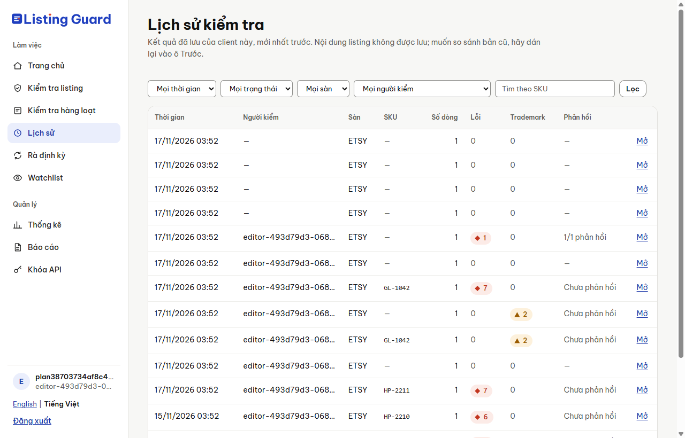
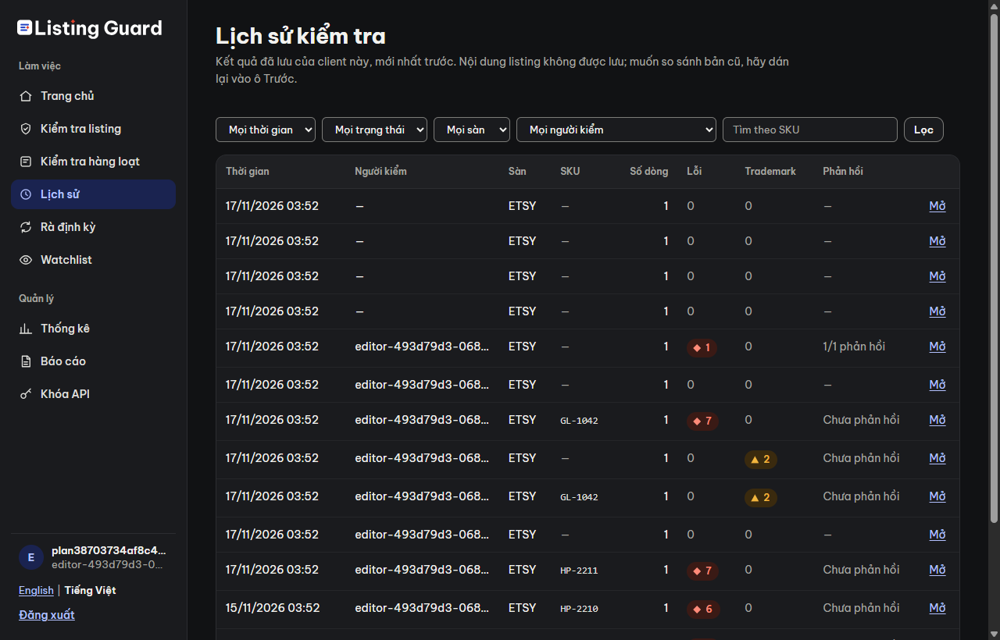
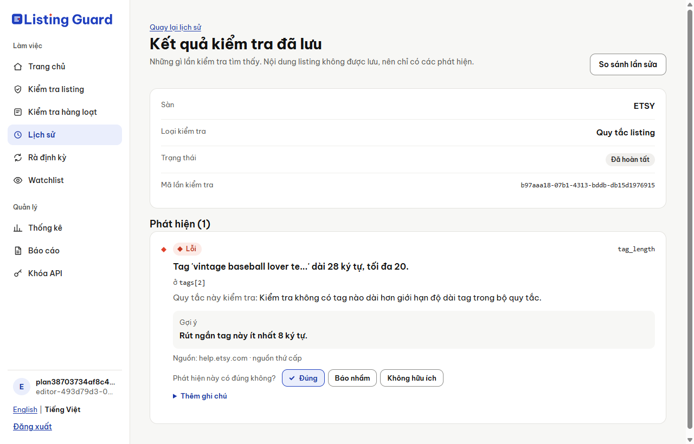
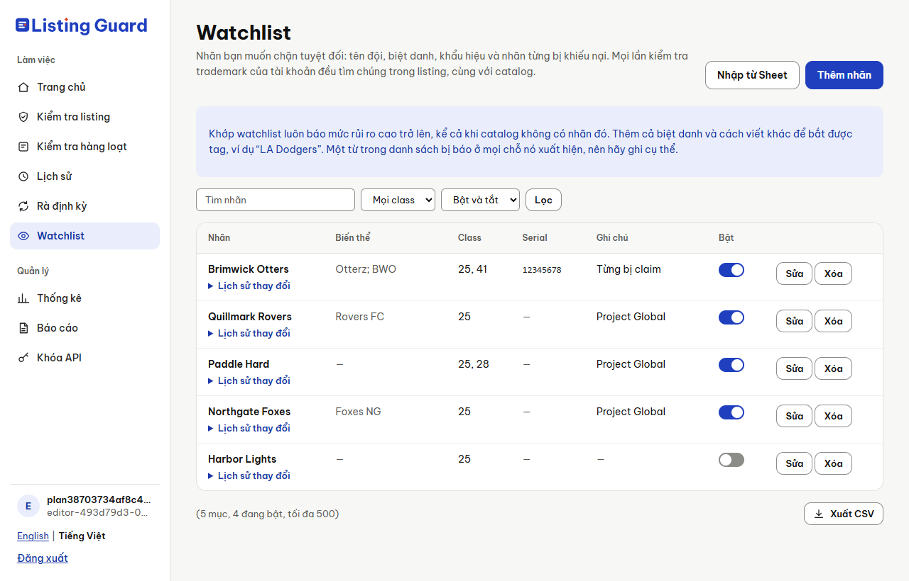
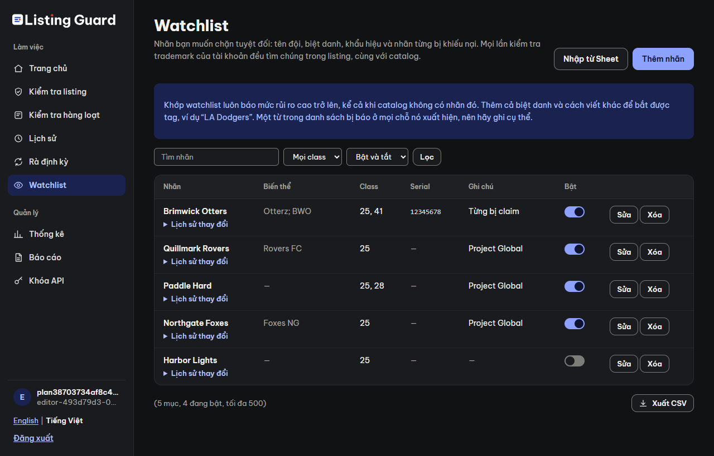
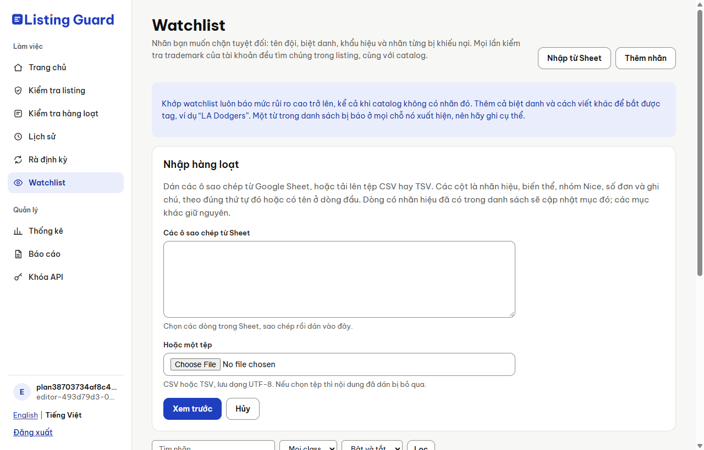
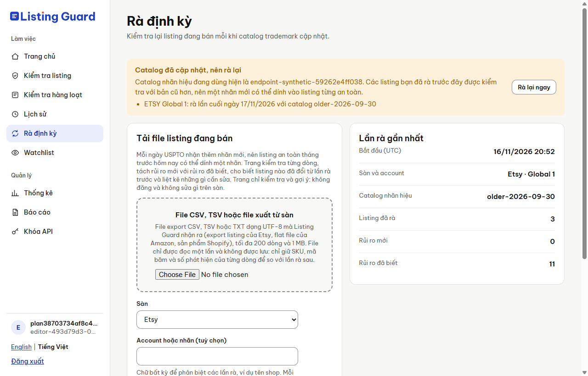
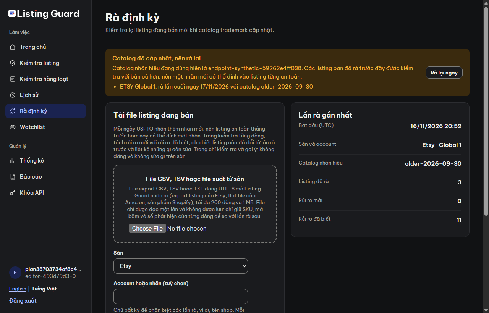
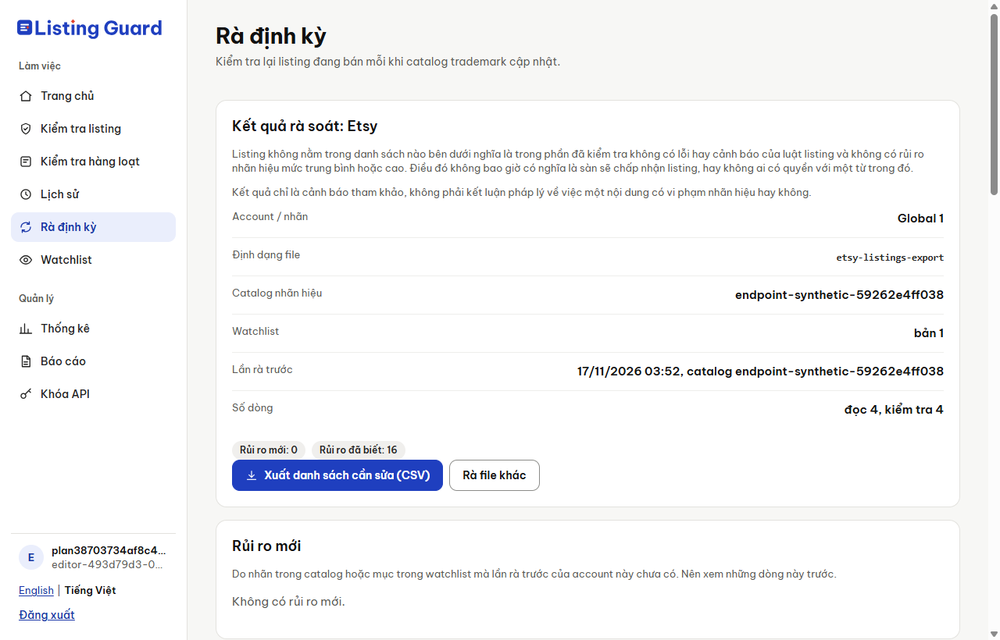
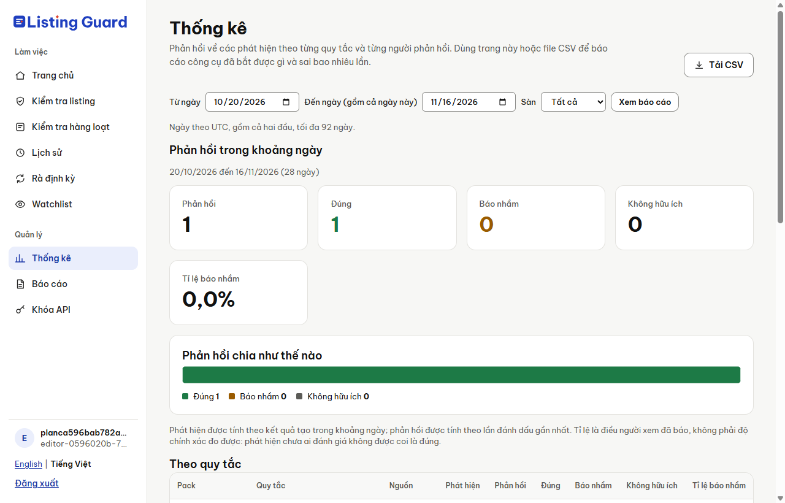
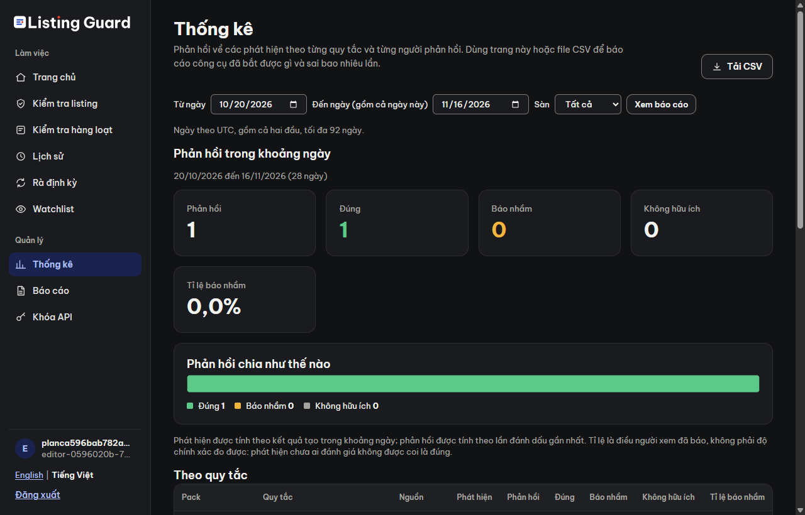
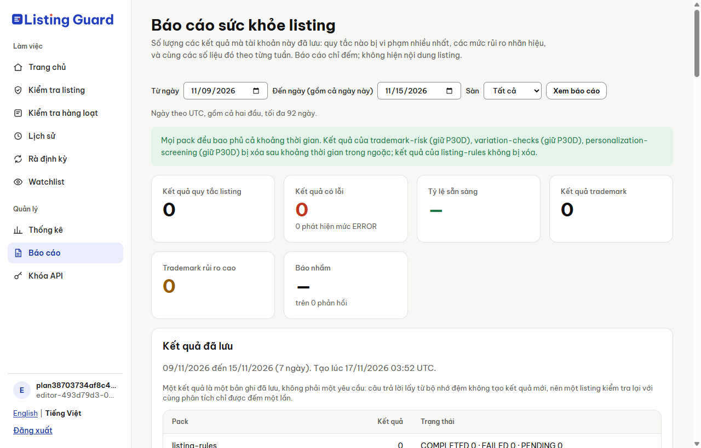
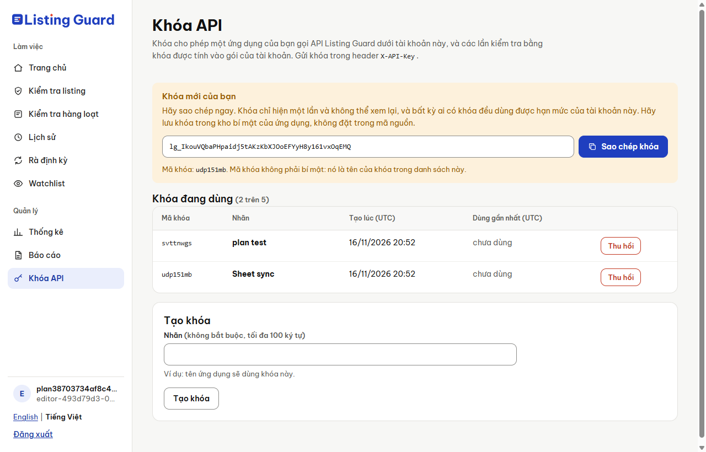
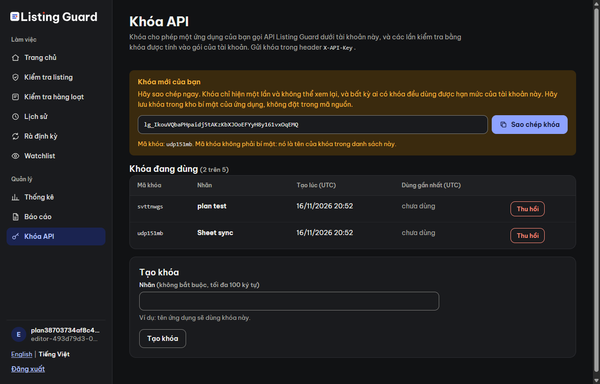

Not measured: Safari and Firefox, a screen reader, and the edit-mode screen, which was not photographed again (its cards changed with ADR-041
section 7, its layout did not).
