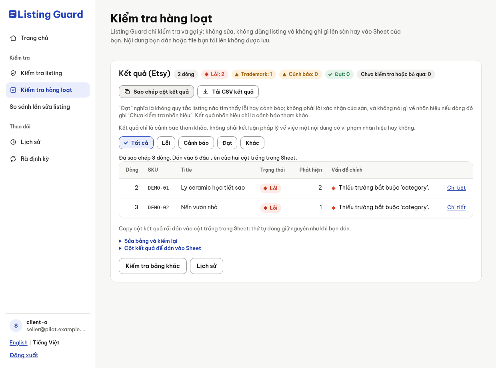

# Dùng thử Listing Guard — Project Global

## 1. Đăng nhập

Mở địa chỉ pilot do lead gửi. Đăng nhập **Cloudflare Access** bằng email đã được mời. Trang chủ hiển thị nhãn **Pilot** và các
chức năng đang hoạt động. Tiếng Việt là mặc định. Bạn có thể chọn **English** trong menu.

## 2. Kiểm, sửa và trả kết quả về Sheet

1. Trong Sheet, sao chép vùng dữ liệu có hàng tiêu đề. Dùng các cột như `SKU`, `Title`, `Description`, `Tags`, `Price`, `Quantity`. Với Etsy, thêm `Who made` và `When made` nếu có.
   Trên trang chủ, bấm **Dán từ Sheet**. Chọn Etsy hoặc Amazon và dán vào ô nhập.
2. Bấm **Tiếp tục: chọn cột**. Xác nhận các cột mà Console tự nhận diện, chỉnh ánh xạ nếu cần, rồi bấm **Kiểm tra N dòng**.
3. Đọc trạng thái từng hàng. Mở chi tiết để xem trường, quy tắc, nhãn hiệu và lý do. Xem xét trước các finding **HIGH**.
   **MEDIUM** cần đọc ngữ cảnh. **LOW** có thể vẫn có finding. **Chưa hoàn tất** nghĩa là còn thiếu dữ liệu hoặc một bước kiểm tra.
4. Mở **Sửa bảng và kiểm lại**. Sửa ô cần thiết hoặc dán lại bảng đã sửa. Giữ các cột và hàng đúng thứ tự, rồi bấm **Kiểm lại các hàng**.
5. Bấm **Sao chép cột kết quả**. Dán hai cột trạng thái và tóm tắt vào ô trống bên cạnh dữ liệu của bạn trong Sheet.

Để kiểm một listing, chọn **Kiểm tra listing**. Bạn có thể chỉnh các trường và kiểm lại từ trang đó. **Lịch sử** mở
kết quả đã giữ. **Rà định kỳ** nhận file xuất hiện tại để kiểm các listing đang bán. Các thao tác kiểm tra không cập nhật marketplace.

## 3. Phản hồi

Ngay dưới finding, bấm **Đúng** nếu cảnh báo mô tả đúng vấn đề. Bấm **Báo nhầm** nếu vấn đề được nêu không có trong trường hợp của bạn.
Bạn có thể đổi phản hồi. Giữ trống ghi chú nếu thông tin liên quan tới người mua hoặc nội dung listing riêng tư. Nếu đăng nhập hoặc kiểm
tra gặp lỗi, gửi lead tên màn hình và trạng thái hiển thị.
