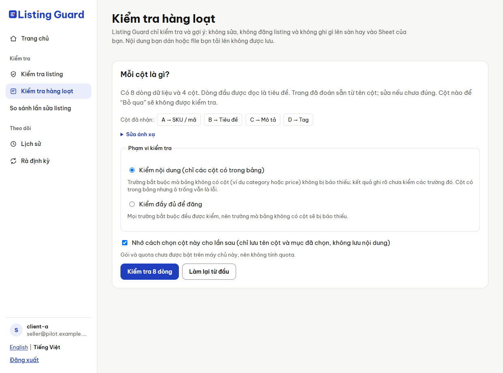

# Dùng thử Listing Guard — Project Global

## 1. Đăng nhập

Mở địa chỉ pilot do lead gửi. Đăng nhập **Cloudflare Access** bằng email đã được mời. Trang chủ hiển thị nhãn **Pilot** và các
chức năng đang hoạt động. Tiếng Việt là mặc định. Bạn có thể chọn **English** trong menu.

## 2. Kiểm, sửa và trả kết quả về Sheet

1. Trong Sheet, sao chép vùng dữ liệu có hàng tiêu đề. Dùng đúng các cột bạn đang viết: `SKU`, `Title`, `Description`, `Tags`. Bạn **không cần**
   cột `Category`, `Price`, `Quantity`, `Who made` hay `When made`: những trường đó điền trên Etsy khi tạo listing. Nếu bảng có các cột đó,
   Console kiểm chúng, và ô trống trong cột có sẵn vẫn là lỗi.
   Trên trang chủ, bấm **Dán từ Sheet**. Chọn Etsy hoặc Amazon và dán vào ô nhập.
2. Bấm **Tiếp tục: chọn cột**. Xác nhận các cột mà Console tự nhận diện, chỉnh ánh xạ nếu cần. Mục **Phạm vi kiểm tra** mặc định là
   **Kiểm nội dung (chỉ các cột có trong bảng)**: trường bảng không có cột không bị báo thiếu. Rồi bấm **Kiểm tra N dòng**.

   

3. Đọc trạng thái từng hàng. Dòng sạch ghi **Đạt (nội dung)**: không quy tắc nào tìm thấy lỗi hay cảnh báo trong các cột bạn có, nhưng các
   trường bắt buộc bảng không có cột **chưa được kiểm**, nên đó chưa phải "sẵn sàng đăng". Ghi chú màu xanh phía trên bảng liệt kê các trường đó.
   Mở chi tiết để xem trường, quy tắc, nhãn hiệu và lý do. Xem xét trước các finding **HIGH**.
   **MEDIUM** cần đọc ngữ cảnh. **LOW** có thể vẫn có finding. **Chưa hoàn tất** nghĩa là còn thiếu dữ liệu hoặc một bước kiểm tra.
   Dòng chữ nhỏ phía trên bảng nhắc rằng kết quả chỉ là cảnh báo tham khảo; bấm **Giải thích kết quả** (mở ở tab mới) để đọc đầy đủ ý nghĩa của "Đạt" và lời miễn trừ về nhãn hiệu.
4. Mở **Sửa bảng và kiểm lại**. Sửa ô cần thiết hoặc dán lại bảng đã sửa. Giữ các cột và hàng đúng thứ tự, rồi bấm **Kiểm lại các hàng**.
5. Bấm **Sao chép cột kết quả**. Dán ba cột trạng thái, tóm tắt và phạm vi vào ba ô trống bên cạnh dữ liệu của bạn trong Sheet.

Ảnh trên là kết quả của bảng mẫu [`docs/samples/sheet-content-sample.tsv`](samples/sheet-content-sample.tsv) (tám listing tự đặt, bốn cột
`SKU`, `Title`, `Description`, `Tags`): ba dòng **Lỗi** (title dài 159 ký tự, tag dài 26 ký tự, mô tả trống), hai dòng **Cảnh báo** (tag trùng, cụm
"Free Shipping" trong title) và ba dòng **Đạt (nội dung)**. Với kiểm đầy đủ, cả tám dòng đều báo **Lỗi** vì bảng không có cột `category`.

Khi chuẩn bị đăng một listing, chọn **Kiểm đầy đủ để đăng** ở bước chọn cột (hoặc dùng **Kiểm tra listing**): lúc đó mọi trường bắt buộc đều
được kiểm. Lựa chọn của bạn được nhớ cùng cách chọn cột nếu bạn tick *Nhớ cách chọn cột này*. Báo cáo pilot đếm hai loại kiểm tra riêng.

Để kiểm một listing, chọn **Kiểm tra listing**. Bạn có thể chỉnh các trường và kiểm lại từ trang đó. **Lịch sử** mở
kết quả đã giữ. **Rà định kỳ** nhận file xuất hiện tại để kiểm các listing đang bán. Các thao tác kiểm tra không cập nhật marketplace.

## 3. Phản hồi

Ngay dưới finding, bấm **Đúng** nếu cảnh báo mô tả đúng vấn đề. Bấm **Báo nhầm** nếu vấn đề được nêu không có trong trường hợp của bạn.
Bạn có thể đổi phản hồi. Giữ trống ghi chú nếu thông tin liên quan tới người mua hoặc nội dung listing riêng tư. Nếu đăng nhập hoặc kiểm
tra gặp lỗi, gửi lead tên màn hình và trạng thái hiển thị.
