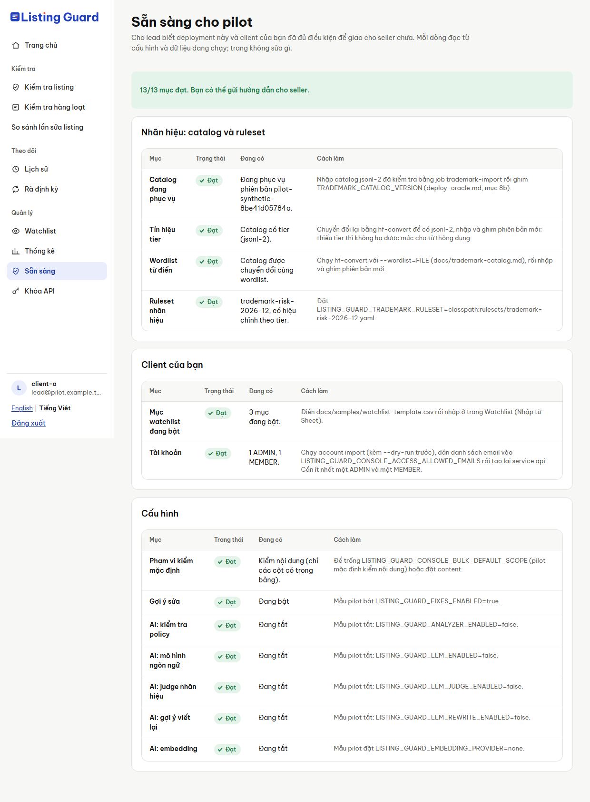

# Checklist dựng pilot cho seller (dành cho lead)

Làm theo thứ tự. Mỗi bước có cách kiểm tra; đừng sang bước sau khi bước trước chưa đạt. Quyết định thiết kế: [ADR-053](adr/ADR-053-pilot-onboarding-kit.md).

**1. Deploy.** Sao chép [`deploy/env.pilot.example`](../deploy/env.pilot.example) thành `.env.pilot`, `chmod 600`, điền placeholder, rồi chạy Compose theo
[deploy-oracle.md mục 11](deploy-oracle.md). Kiểm tra: `/health` trả `UP`, đăng nhập Cloudflare Access thấy nhãn **Pilot**, ngôn ngữ tiếng Việt.

**2. Đo và ghim catalog.** Trên image `0.11.0`, chạy [runbook kích hoạt catalog](catalog-activation-runbook.md)
để convert, import và chạy cổng 47 ca trên catalog thật với hai ruleset. **Trạng thái hiện tại: chưa đo.** Sau khi đạt cổng,
ghi lại phiên bản đầy đủ (gồm digest), ghim vào `TRADEMARK_CATALOG_VERSION` và tạo lại `api`. Giữ
`LISTING_GUARD_TRADEMARK_RULESET=classpath:rulesets/trademark-risk-2026-12.yaml`. Kiểm tra lại sau bước 5.

**3. Nhập account.** Soạn `accounts.csv` từ [`docs/samples/accounts-template.csv`](samples/accounts-template.csv) (cột `email`, `role`, `display_name`, `client`; một ADMIN cho lead,
còn lại MEMBER). Chạy thử trước, rồi chạy thật:

```bash
docker compose --env-file .env.pilot -p listing-guard-pilot --profile prod --profile admin run --rm \
  -v "$PWD/accounts.csv:/data/accounts.csv:ro" admin account import /data/accounts.csv --create-clients --dry-run
# đọc kết quả; khi không còn "Problem", bỏ --dry-run để ghi
```

Lệnh không gửi email. Nó in danh sách email: **dán danh sách đó vào `LISTING_GUARD_CONSOLE_ACCESS_ALLOWED_EMAILS`** (và vào chính sách Allow của Cloudflare Access), rồi tạo lại `api`.
Chạy lại cùng file không tạo bản sao; đổi vai trò trong file thì lần chạy sau cập nhật vai trò. `display_name` chỉ để bạn ghi chú, không được lưu.

**4. Nhập watchlist.** Điền [`docs/samples/watchlist-template.csv`](samples/watchlist-template.csv) theo [hướng dẫn](pilot-watchlist-guide.md): tên đội, biệt danh, slogan, nhãn từng bị claim.
Đăng nhập bằng ADMIN, mở **Watchlist → Nhập từ Sheet**, đọc bảng xem trước, xác nhận.

**5. Mở trang Sẵn sàng.** Đăng nhập bằng ADMIN, mở **Quản lý → Sẵn sàng**. Mục tiêu là **mọi dòng Đạt**. Mỗi dòng Thiếu có một dòng *Cách làm* ngay bên cạnh.
Catalog phải có tier và wordlist, ruleset là `trademark-risk-2026-12`, watchlist có ít nhất một mục đang bật, có ADMIN và MEMBER đều được phép đăng nhập, phạm vi kiểm mặc định là nội dung,
các cờ AI tắt.



**6. Gửi hướng dẫn cho seller.** Gửi [hướng dẫn một trang](pilot-seller-guide.md) và địa chỉ pilot. Nhắc seller ba điều: bảng chỉ cần cột `SKU`, `Title`, `Description`, `Tags` (kiểm nội dung);
**Đạt (nội dung)** chưa phải sẵn sàng đăng; liên kết **Giải thích kết quả** ở trang kết quả nói rõ ý nghĩa và lời miễn trừ.

Sau đó: mỗi tuần mở **Thống kê → Báo cáo pilot**; khi kết thúc, xuất báo cáo cuối và gỡ quyền Access (deploy-oracle.md mục 11).
