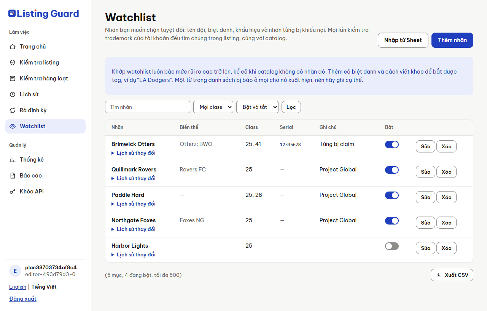

# Client trademark watchlist

A client's own short list of names to watch, scanned by every trademark check next to the catalog
([ADR-031](adr/ADR-031-client-trademark-watchlist.md)). It exists because a catalog built from the whole USPTO register
reports ordinary words, while a seller knows its own risks better than any register: the team names, nicknames and slogans of
the sports teams whose colors its products use (it sells the colors, not the marks), and the marks it has already received a
claim for. Sellers keep that list in a Google Sheet; this page is how it gets into Listing Guard.

It checks and suggests, like the rest of the product. It never edits a listing, never publishes, and the answer is a reference
warning, not a legal conclusion.

## What an entry is

| Field | Meaning |
|---|---|
| `mark` | The name, as it should be reported. It identifies the entry. |
| `aliases` | Other ways it is written: a nickname, a short form, a slogan. At most 20. |
| `niceClasses` | Nice classes (1 to 45) the client notes. They are shown with a match and **do not change its level**. |
| `serialNumber` | A USPTO serial number (eight digits), optional. A finding then carries the source id `uspto:<serial>` and its TSDR look-up link. |
| `note` | Why it is listed, for example "từng bị claim". Shown in the finding's message. |
| `enabled` | `false` keeps the entry without scanning for it. |
| `addedBy`, `addedAt`, `updatedBy`, `updatedAt` | Who and when: `console:<account id>` or `api-key:<key id>`, never an e-mail or a secret. |

**Two names are one name** when they are equal after the normalization the catalog's marks get: case, accents, punctuation,
apostrophes, look-alike letters and leetspeak. `Go-Team!`, `go team` and `GO TEAM` are one mark, and a list may not hold two of
them (a mark or an alias), whether the entries are on or off. Entering the same Sheet twice therefore updates and never duplicates,
and an entry keeps its id, `addedBy` and `addedAt` while its mark keeps its normalized form.

Limits (`listing-guard.trademark.watchlist.*`, operational settings): 500 entries, 20 aliases, 100 characters a mark or alias,
500 characters a note, 12 words a mark or alias.

## What a check does with it

- The marks and aliases of the **enabled** entries are looked for in every scanned field (title, tags, description, brand, shop
  name, bullet points, search terms) as an exact run of words. A run may be as long as the entry (a six-word slogan is found),
  there is **no fuzzy match**, and a word inside another word is not a match.
- A match is a finding with `ruleId` `watchlist_match` and **`source` `WATCHLIST`** (catalog findings are `CATALOG`, the place and
  color rules `CONTEXT`). Its `watchlistEntry` names the entry: id, mark, the alias that matched (null when the mark did), classes,
  serial number and note.
- Its level is **at least `minimum_risk` (HIGH by default)** and at least the level of any other finding over the same span; it wins
  the span against every other rule, which are listed in `otherRuleIds`. Product types and generic words never lower it: the client
  listed the word on purpose.
- `watchlist` in the answer says which list was used: `revision`, `version` (a hash of the enabled entries) and `entries`.
- **Cache identity.** While a client has at least one enabled entry, the hash of its entries, the watchlist settings and the matcher
  version are part of its `analysisVersion`. Any change to an enabled entry, switching one on or off, or another settings file
  therefore misses the cache (the next check of a listing is a new analysis and uses a unit of quota where plans are on). An identical
  list, even rebuilt by a paste, hits it. A client with no enabled entry keeps the `analysisVersion` it always had.
- Another client's list never affects yours.

### When the deployment serves no catalog

A trademark check of a client that has an enabled entry is answered `200` instead of `503 trademark-not-configured`:

- `catalogStatus` is `NOT_CONFIGURED` and `catalogVersion` is `none` (a real catalog version always ends with a digest, so it can never
  be `none`);
- only the watchlist and the rules that need no catalog (`geo_sport_combination`) ran; `skippedRuleIds` lists the catalog rules and the
  color rules that read them;
- `completeness` is `INCOMPLETE`, so the result is stored for `GET` and never reused or charged, and `riskLevel` is the highest level
  found or `UNKNOWN`, **never `LOW`**: no catalog finding there says nothing about the catalog;
- a client with no enabled entry still gets the `503`, exactly as before.

The console editor, the console bulk check and `batch-check` call the same service and behave the same way.

## The console page

<picture>
  <source media="(prefers-color-scheme: dark)" srcset="images/console/watchlist-dark.png">
  
</picture>

`/console/watchlist` (menu "Watchlist", in English and Vietnamese). Every account of the client can read it and export it; **only an
`ADMIN` account changes it**: add, edit, switch off or on, delete, import. A `MEMBER` sees the list read only with a note, and every
write route answers it `403`. The role is read from the database at each request.

- **The page** has a banner that says a match is reported at the level of the setting or higher, a filter row (a word, a Nice class, on
  or off; it narrows the table only) and a table in which the mark is the name of its row. The switch of a row is a button with a state for an
  administrator and a picture with a word for a member. The add form, the edit form and the import open from the address (`?add`, `?edit=`,
  `?import`), so the page needs no script and the back button closes them ([ADR-042](adr/ADR-042-console-manage-pages.md)).

- **A magic-link account** owns the client made for it, so it is an `ADMIN`. **An account of the shared Cloudflare Access client**
  (ADR-027), and any account an operator made, is a `MEMBER` until the operator promotes it.
- Every change replaces the whole list under the client's row lock with the revision the page was built from. If someone changed the
  list in between, the page says so (`409`) and shows the current list; nothing is lost silently.
- **Import** (paste from a Google Sheet, or upload a CSV/TSV saved as UTF-8) is two steps and the server keeps nothing between them:
  a preview says what each row would do (adds, updates, changes nothing, or is refused and why), and a confirmation applies it. One
  refused row stops the whole import; correct it in the Sheet and import again. Rows are merged by normalized mark: a row whose mark is
  already listed updates that entry, the other entries stay.
- **Columns**, in this order or named in a first row (English or Vietnamese names, any order, unknown columns ignored): `mark`, `alias`,
  `classes`, `serial`, `note`, and optionally `enabled`. Aliases in one cell are separated by `;`, `|` or a line break, classes by `;`,
  `,` or spaces. A Sheet's copy is tab separated; a cell with a tab or line break is in double quotes.
- **Export CSV** writes the same columns with `enabled`, in UTF-8 with a byte order mark so a spreadsheet reads Vietnamese letters. A cell
  that starts with `=`, `+`, `-` or `@` is written with a leading `'` so a spreadsheet shows it instead of running it, and an import
  removes that `'` again.

## The API

Both operations need an API key and the `trademark-risk` plan pack where plans are on, and cost no quota. The client is the key's; there
is no client parameter.

- `GET /api/v1/trademark-watchlist`: the list (`revision`, `version`, `updatedAt`, `entries[]`, `limits`) with `ETag: "<revision>"`; send
  `If-None-Match` for a `304`. A client that never had a list reads `revision` 0 and no entries.
- `PUT /api/v1/trademark-watchlist`: replaces the whole list with `entries[]` (`mark`, optional `aliases`, `niceClasses`, `serialNumber`,
  `note`, `enabled`). With `If-Match: "<revision>"` it replaces only if the list is still at that revision, else `412
  watchlist-revision-mismatch` with `currentRevision`. Every problem of the list is returned at once as `400 invalid-request` with
  `errors[]` (`field` such as `entries[3].aliases[1]`, `message`), and nothing is stored. An identical list changes nothing, not even the
  revision.

```bash
curl -X PUT https://listing-guard.example/api/v1/trademark-watchlist \
  -H "X-API-Key: $LISTING_GUARD_API_KEY" -H "Content-Type: application/json" -H 'If-Match: "3"' \
  -d '{"entries": [{"mark": "Brimwick Otters", "aliases": ["Otterz", "BWO"], "niceClasses": [25], "note": "từng bị claim"}]}'
```

An API key acts for its client, so a key can replace the list whatever the roles of the console accounts say. A client that wants only
its administrators to edit the list should not hand a key to its members.

The Java SDK has `trademarkWatchlist()` and `replaceTrademarkWatchlist(request, expectedRevision)` (the one `PUT` of the SDK, and a
`WatchlistRevisionMismatchException`). The MCP server has one read-only tool, `get_watchlist`; **no tool changes a list**
([ADR-017](adr/ADR-017-mcp-server.md)).

## Settings and the operator

- `listing-guard.trademark.watchlist.settings`: the versioned settings file (`classpath:watchlist/trademark-watchlist-2026-11.yaml`): the
  minimum level of a watchlist finding (`minimum_risk: HIGH`) and the Vietnamese messages. Like a ruleset, a published version is
  immutable (a test pins its hash): another minimum is a file of the operator's own with its own `version`, named in this setting.
  Every `source.status` must be `unverified`: the list is the client's own, not a marketplace or legal rule.
- `listing-guard.trademark.watchlist.max-entries`, `max-aliases`, `max-text-chars`, `max-note-chars`, `max-tokens`: the limits above.
- The admin job: `account list <client>` shows the console accounts of a client with their roles; `account role <email> ADMIN|MEMBER`
  changes one (it takes effect on the account's next page).

```bash
docker compose run --rm admin account list web-1a2b3c4d5e6f
docker compose run --rm admin account role seller@example.com ADMIN
```

Migration **V38** is additive: `account.role`, `trademark_watchlist`, `trademark_watchlist_entry`, and the columns a check made without a
catalog needs (`trademark_check.catalog_version_id` becomes nullable, `skipped_rule_ids`, `watchlist_revision`, `watchlist_version`,
`watchlist_entries`, and `trademark_check_finding.watchlist_entry`). V38 makes an account that is the only account of a `web-…` client an
`ADMIN`; every other existing account is a `MEMBER`.

## What it does not do

- It does not read a Google Sheet by itself: the seller pastes or uploads it (a Sheet connector is reserved, ADR-031 open question 5).
- It does not use Nice classes to lower a level (open question 2) and does not match near spellings.
- Personalization screening (ADR-016) does not read it (open question 3).
- It is not a verdict that a listed word is infringing or that an unlisted one is safe.
- Listing text is never stored; only the list, and for each check the hash and bounded evidence, as for every trademark result. The
  health report counts watchlist findings but never shows a watchlist mark.
