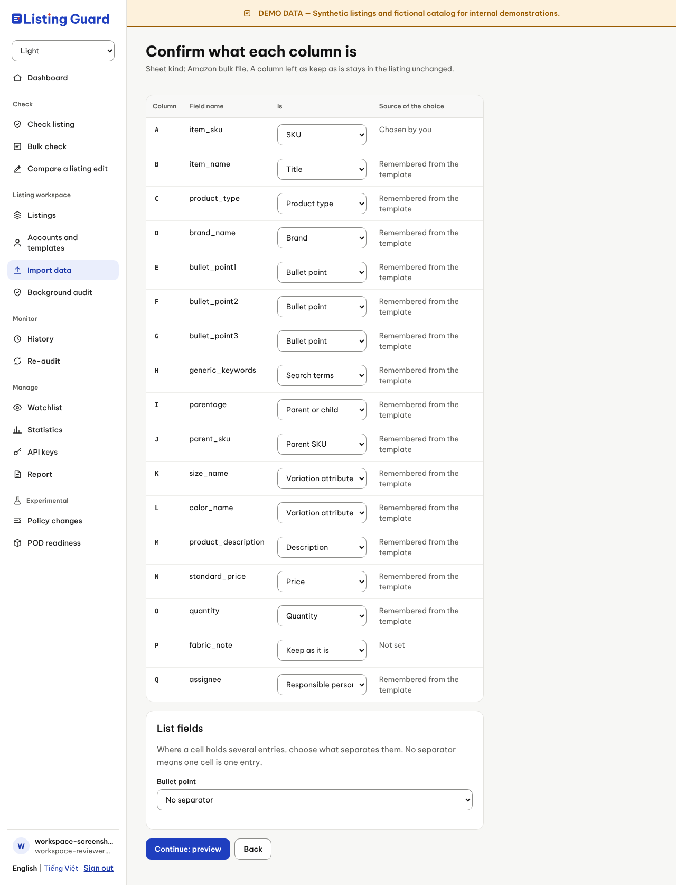
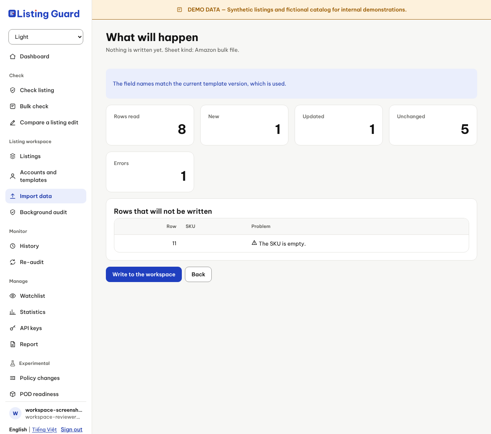
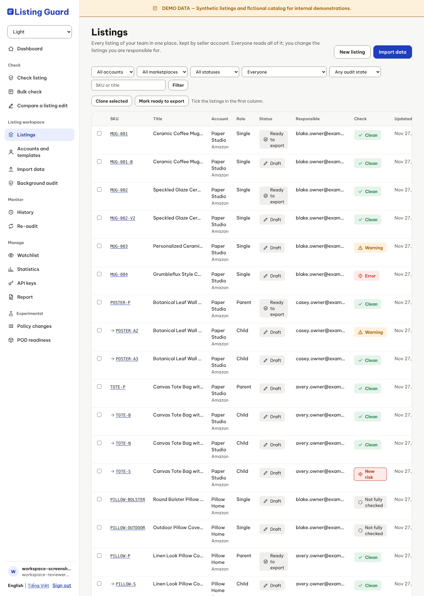
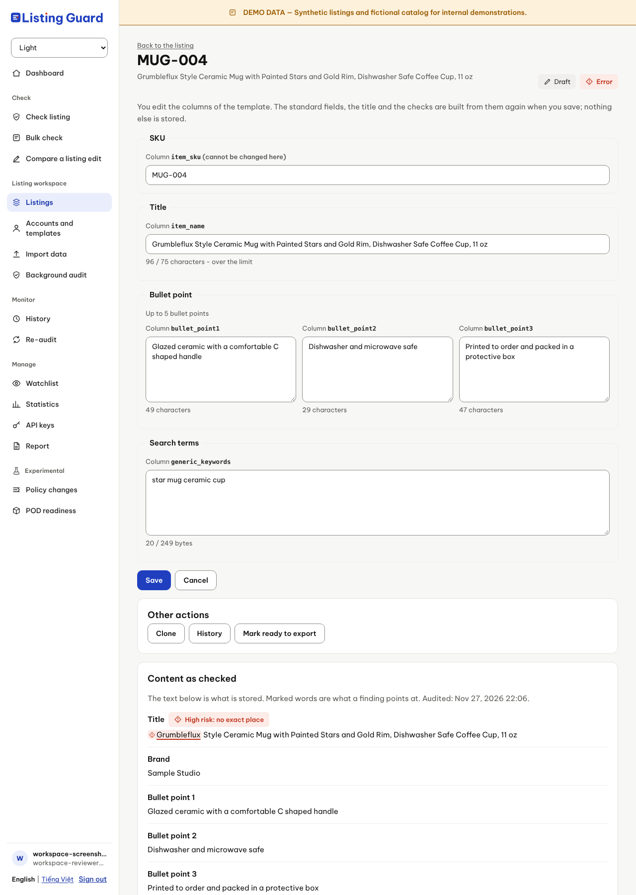
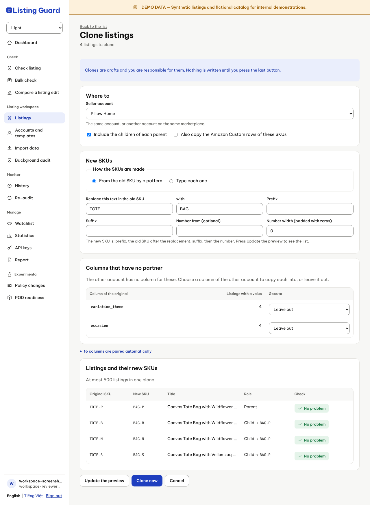
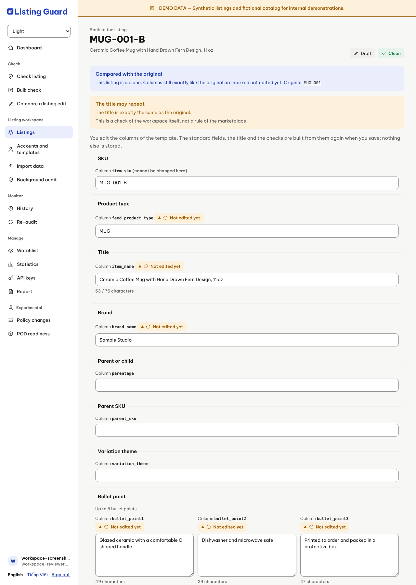
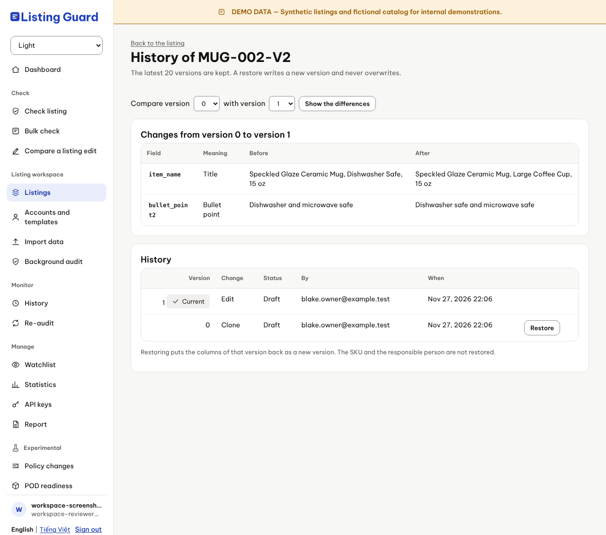
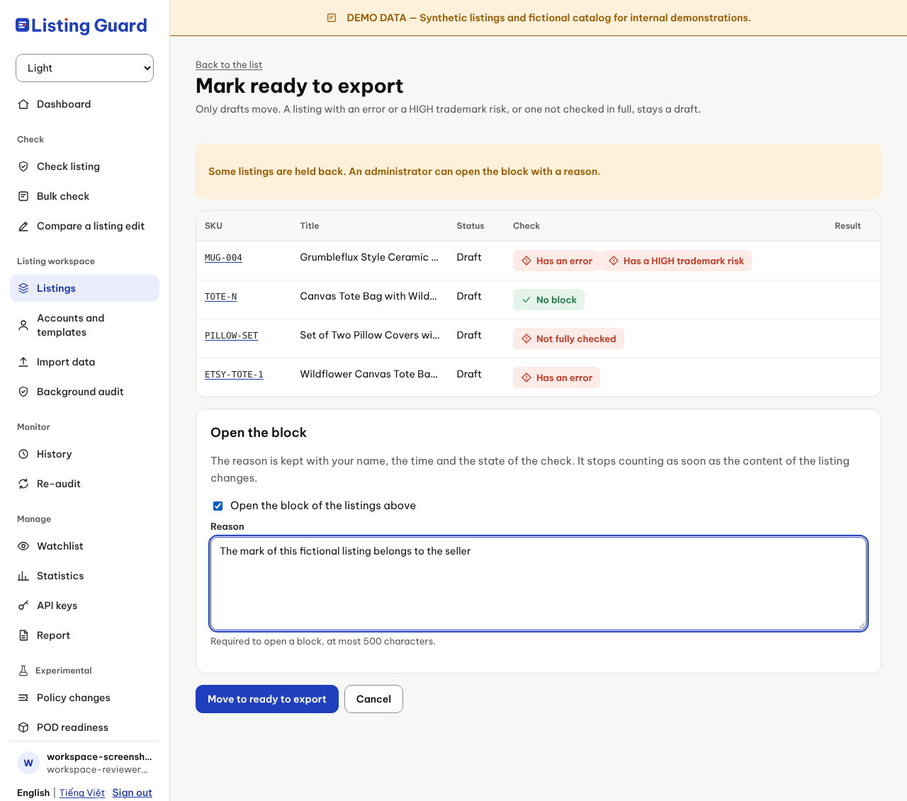
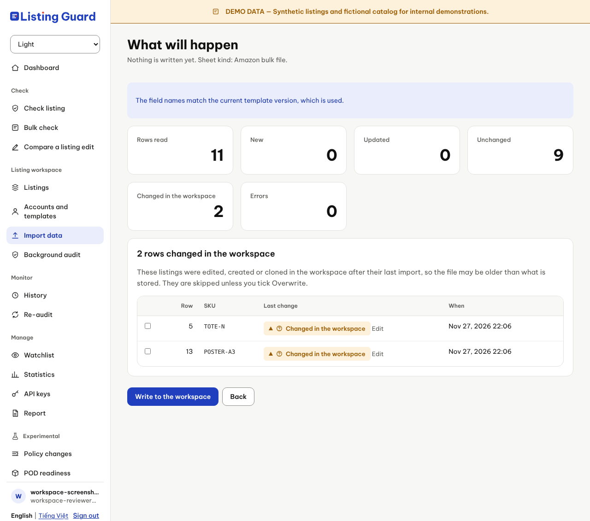

# Kho listing (Listing workspace)

Tài liệu này mô tả kho listing của ADR-059: nơi lưu listing để hệ thống rà và cảnh báo trên dữ liệu đã lưu, thay cho Google Sheet. PR nền này
làm **kho, template theo tài khoản và nhập dữ liệu**. **Rà nền, tô đỏ và email cảnh báo (W2, ADR-061) có ở [mục 9](#9-rà-nền-tô-đỏ-và-email-adr-061)** và tắt mặc định.
**Trình soạn, tạo mới, nhân bản, lịch sử, trạng thái "Sẵn sàng xuất" và xung đột khi nhập lại (W3, ADR-062) có ở [mục 11](#11-trình-soạn-tạo-mới-nhân-bản-adr-062).** Xuất file `.xlsm`/`.txt` (W4) là PR sau.

> **Chưa xác minh với template Amazon thật.** Repo chưa có template Amazon của HappyC. Mọi fixture là tổng hợp, và danh sách tên cột dùng để
> *đoán* (`api/src/main/resources/workspace/standard-targets.yaml`) đều ghi `unverified`. Đoán chỉ điền sẵn, người dùng luôn xác nhận.
> Chưa rõ Amazon của HappyC nhận `.xlsm` hay `.txt`: kho đọc cả hai, và định dạng xuất mặc định của từng tài khoản (`XLSM`/`TXT`) chỉ được dùng ở W4.

## 1. Khái niệm

| Khái niệm | Ý nghĩa |
| --- | --- |
| **Tài khoản bán** | Một tài khoản Amazon hoặc một shop Etsy của client (không phải tài khoản đăng nhập Console). Có sàn, tên, brand tuỳ chọn, định dạng xuất mặc định, bật/tắt. |
| **Template** | Của một tài khoản, theo loại (`AMAZON_BULK` bulk file, `AMAZON_CUSTOM` cấu hình Amazon Custom, `ETSY_FIELDS` các mục chính của Etsy) và theo **version**. Một version là *đúng dòng tên field*: header khác (thêm, bớt, đổi thứ tự, đổi chữ) là version mới; version cũ vẫn dành cho listing đang dùng. |
| **Listing** | Một dòng dữ liệu của tài khoản, duy nhất theo `(tài khoản, SKU)` khi chưa xoá. Lưu mọi cột của template (cột chưa gán trường chuẩn được giữ nguyên: *passthrough*) và các trường chuẩn (`title`, `bullet_points`, `description`, `search_terms`/`tags`...) theo `docs/input-schema.md` để kiểm sau này. |
| **Vai trò** | `PARENT` / `CHILD` / `STANDALONE`, suy từ cột parent/child (nếu có) và cột SKU cha. |
| **Người phụ trách** | Tài khoản Console của client chịu trách nhiệm về listing. |
| **Trạng thái** | Nháp, Sẵn sàng xuất, Đã xuất, Đang bán. Listing mới nhập lấy trạng thái chọn ở bước 1 (mặc định Nháp); listing đã có giữ trạng thái cũ. |
| **Nguồn** | Nhập từ file (`IMPORT`), nhân bản (`CLONE`), tạo mới (`NEW`) ([mục 11](#11-trình-soạn-tạo-mới-nhân-bản-adr-062)). |
| **Customize** | Dòng của sheet Amazon Custom, nối với listing theo SKU khi đọc. Dòng chưa có listing vẫn được giữ và được báo. |
| **Lịch sử** | N phiên bản gần nhất của mỗi listing (mặc định 20, `listing-guard.workspace.history-keep`). |

Kho là **nơi duy nhất** lưu text listing. API kiểm (`/api/v1/checks`...), Kiểm hàng loạt, chế độ sửa, rà định kỳ và báo cáo vẫn không lưu text listing và không đọc kho.

## 2. Bật tính năng

Tắt mặc định. Khi tắt: không có menu "Kho listing", mọi đường dẫn `/console/workspace/**` trả 404 và hành vi cũ giữ nguyên.

| Biến môi trường | Mặc định | Ý nghĩa |
| --- | --- | --- |
| `LISTING_GUARD_WORKSPACE_ENABLED` | `false` | Bật kho. Cần `LISTING_GUARD_CONSOLE_ENABLED=true`. |
| `LISTING_GUARD_WORKSPACE_MEMBER_EDIT_SCOPE` | `own` | `own`: thành viên chỉ sửa listing mình phụ trách; `all`: sửa mọi listing của client. ADMIN luôn toàn quyền. |
| `LISTING_GUARD_WORKSPACE_MAX_TEMPLATE_BYTES` | `10MB` | File template lớn nhất. |
| `LISTING_GUARD_WORKSPACE_IMPORT_MAX_BYTES` | `20MB` | File hoặc vùng dán lớn nhất của một lần nhập. |
| `LISTING_GUARD_WORKSPACE_IMPORT_MAX_ROWS` | `10000` | Số dòng dữ liệu tối đa. Vượt trần thì từ chối cả file, không cắt. |
| `LISTING_GUARD_WORKSPACE_HISTORY_KEEP` | `20` | Số phiên bản giữ cho mỗi listing. |
| `LISTING_GUARD_MULTIPART_MAX_FILE_SIZE` / `LISTING_GUARD_MULTIPART_MAX_REQUEST_SIZE` | `10MB` / `60MB` (theo ảnh) | Trần upload của Spring. **Phải ≥ trần nhập/template**: mặc định 20 MB cần đặt `25MB`; ứng dụng không khởi động nếu thấp hơn và báo đúng tên biến. |

## 3. Quyền

- Thành viên (MEMBER) của client **xem toàn bộ kho** của client.
- MEMBER **chỉ sửa listing mình phụ trách** (với `own`). "Sửa" là nhập dữ liệu ghi đè listing đã có, **sửa trong trình soạn**, khôi phục một phiên bản và chuyển trạng thái; listing mới nhập, tạo mới hoặc nhân bản bởi MEMBER được giao cho chính họ. Dòng thuộc listing của người khác bị báo lỗi và không ghi. MEMBER **nhân bản được listing của người khác** (bản nhân bản là nháp của chính họ) và mở listing đó ở dạng chỉ đọc.
- Mở chặn "Sẵn sàng xuất" kèm lý do là việc của ADMIN ([mục 11.6](#116-trạng-thái-sẵn-sàng-xuất)).
- ADMIN toàn quyền: quản lý tài khoản bán, tải template và đổi ánh xạ cột, nhập cột người phụ trách, đổi người phụ trách, xoá (xoá mềm), tải file template gốc.
- MEMBER không tạo template và không đổi ánh xạ; khi header của file khác version hiện hành, việc nhập bị chặn với lời nhắc nhờ ADMIN tải template mới.
- Vai trò đọc từ cơ sở dữ liệu ở mỗi request. Listing của client khác luôn là 404, không phải 403.

## 4. Tải template (ADMIN)

1. **Kho listing → Tài khoản và template** → *Thêm tài khoản bán* (tên, sàn, brand, định dạng xuất). Tài khoản Etsy tự có template là danh sách mục chính cố định (`workspace/etsy-fields.yaml`, `unverified`), không cần tải file.
2. Với tài khoản Amazon: *Tải template* → chọn loại (`Amazon bulk file` hoặc `Amazon Custom`) và file `.xlsm`, `.xlsx`, `.tsv` hoặc `.csv`.
3. **Sheet và dòng**: hệ thống liệt kê các sheet và **đoán** sheet template cùng dòng tên field (dòng có nhiều ô viết liền như `item_sku`). Ô đoán có nhãn *Đoán*. Bạn xác nhận sheet, dòng tên field, dòng dữ liệu đầu tiên và cột SKU.
4. **Cột**: xác nhận từng cột là gì (SKU, SKU cha, cha/con, kiểu biến thể, tiêu đề, bullet point, mô tả, từ khóa, thuộc tính biến thể...). Cột để *Giữ nguyên* vẫn nằm trong listing.
5. *Lưu template*. Với file Excel, **nguyên file gốc** được lưu (kèm sha256, tên sheet, dòng tên field, dòng dữ liệu đầu tiên). Với mọi định dạng, các dòng phía trên dòng dữ liệu (dòng cài đặt, dòng nhãn, dòng tên field) và thứ tự cột được giữ **nguyên văn**.

File có cùng dòng tên field với version hiện hành không tạo version mới (chỉ cập nhật ánh xạ). Header khác tạo version mới. `.xlsm`: macro không bao giờ được chạy; file được giữ nguyên byte để W4 xuất lại có macro. Template tối đa 10 MB; file nhập kèm dữ liệu lớn hơn mức này không dùng làm template được: hãy tải file template không kèm dòng dữ liệu.

## 5. Nhập lần đầu từ Excel hoặc Google Sheet

Từ Google Sheet: **File → Download → Microsoft Excel (.xlsx)** (hoặc `.tsv`), rồi tải file lên. Cũng có thể sao chép vùng ô và dán vào ô *Hoặc dán vùng ô* (kèm dòng tên field).

1. **Chọn và tải lên**: tài khoản, loại sheet, người phụ trách mặc định (MEMBER: luôn là chính họ), trạng thái của listing mới, file hoặc vùng dán.
2. **Sheet và dòng**: xác nhận sheet, dòng tên field, dòng dữ liệu đầu tiên và **cột SKU** (đoán theo tên kiểu `item_sku`, `sku`, `seller sku`; có nhãn *Đoán*).
3. **Cột**: ánh xạ cột → trường chuẩn. Ánh xạ được nhớ theo template (như Kiểm hàng loạt nhớ ánh xạ), lần sau chỉ cần xem lại. Cột có chữ *Đoán* chỉ là gợi ý. Với Etsy, nhiều cột `TAG1…TAG13` cùng gán cho `Tags` thì thành danh sách; cột không đặt được vào mục cố định nào được giữ làm passthrough.
4. **Xem trước**: số dòng **mới / cập nhật / không đổi / lỗi**, từng lỗi kèm số dòng, và việc sẽ làm với template. Chỉ khi bấm *Ghi vào kho* mới ghi.


<picture>
  <source media="(prefers-color-scheme: dark)" srcset="images/console/workspace-import-sheet-dark.png">
  
</picture>

<picture>
  <source media="(prefers-color-scheme: dark)" srcset="images/console/workspace-mapping-dark.png">
  
</picture>

<picture>
  <source media="(prefers-color-scheme: dark)" srcset="images/console/workspace-preview-dark.png">
  
</picture>

Chưa có template Amazon cho tài khoản: lần nhập đầu (ADMIN) tạo template từ chính file đó.

Chạy lại cùng file **không nhân đôi** và không đổi phiên bản listing. Lỗi theo dòng (dòng lỗi không bị ghi và không bị đoán): thiếu SKU, SKU quá dài, **SKU trùng trong file** (mọi dòng có SKU đó), SKU cha trùng chính nó, **parent không tồn tại** (không có trong file cũng không có trong tài khoản), dòng "con" không có SKU cha, người phụ trách không phải tài khoản của nhóm, listing của người khác (MEMBER, `own`). Việc ghi chạy trong một giao dịch, tuần tự theo tài khoản bán; listing bị người khác sửa giữa lúc xem trước và ghi được giữ nguyên và báo là xung đột.

Giới hạn mặc định: 10.000 dòng, 20 MB, 1.500 cột. File có mật khẩu hoặc mã hóa, file `.xls` cũ, file hỏng, file quá lớn và zip bomb bị từ chối với lý do. Công thức được đọc theo giá trị đã lưu trong ô, không tính lại.

## 6. Trang của Console

- **Danh sách listing**: lọc theo tài khoản, sàn, trạng thái, người phụ trách; tìm theo SKU hoặc tiêu đề; listing con nằm dưới listing cha; phân trang 50 dòng. Cột *Kiểm tra* là **Chưa kiểm** khi rà nền tắt; khi bật là **Sạch / Cảnh báo / Lỗi / Rủi ro mới / Chưa rà đủ** (chữ và biểu tượng) kèm bộ lọc theo trạng thái rà ([mục 9](#9-rà-nền-tô-đỏ-và-email-adr-061)).

<picture>
  <source media="(prefers-color-scheme: dark)" srcset="images/console/workspace-list-dark.png">
  
</picture>

- **Rà nền** (chỉ khi bật): tiến độ x/y theo tài khoản bán, lịch sử lượt rà, nút Rà lại tài khoản (ADMIN), công tắc email của riêng bạn.
- **Chi tiết**: các trường theo thứ tự template (cột passthrough có nhãn), listing con, dòng Amazon Custom, lịch sử, và nút **Sửa**, **Nhân bản**, **Lịch sử**. ADMIN đổi người phụ trách hoặc xoá. Cột đầu của danh sách là ô chọn: **Nhân bản đã chọn** và **Chuyển Sẵn sàng xuất**; nút **Tạo listing mới** ở đầu trang.
- **Tài khoản và template**: danh sách tài khoản, các version template (ADMIN tải được file gốc), form thêm/sửa tài khoản.
- **Nhập dữ liệu**: bốn bước ở mục 5.

## 7. Sao lưu, xuất, xoá dữ liệu

- **Sao lưu**: kho nằm trong PostgreSQL nên bản sao lưu PostgreSQL hiện có (xem `docs/deploy-readiness.md`) **đã gồm kho, kể cả file template gốc** (`bytea`) và file nhập đang chờ giữa các bước. Không có kho lưu riêng.
- **Xuất** (job `admin`, một lần):

  ```bash
  docker compose run --rm admin workspace export --client=<id|tên-client> [--out=<thư-mục>] [--include-deleted]
  ```

  Ghi vào thư mục mới: mỗi version template một file `<tài-khoản>__<loại>__v<N>.tsv` (các dòng phía trên dữ liệu nguyên văn, dòng tên field thêm cột `_json`, mỗi listing một dòng kèm JSON đầy đủ), file template gốc trong `templates/`, và `manifest.json`. Giá trị được ghi như đã lưu; mở file như dữ liệu, không bấm đúp mở bằng Excel.
- **Xoá** (xác nhận hai bước, không hoàn tác):

  ```bash
  docker compose run --rm admin workspace purge --client=<id|tên-client>                    # chỉ đếm, in mã xác nhận
  docker compose run --rm admin workspace purge --client=<id|tên-client> --confirm=<mã>     # xoá
  ```

  Xoá mọi hàng `workspace_*` của client trong một giao dịch (listing, lịch sử, Amazon Custom, template kèm file, file chờ, tài khoản bán) và không đụng bảng nào khác. Mã phụ thuộc số lượng hiện tại: dữ liệu đổi giữa hai lần chạy thì mã không còn khớp và lệnh từ chối. Hai lệnh dùng được cả khi cờ đã tắt.
- Xoá một listing trên Console là xoá mềm: listing biến khỏi danh sách, lịch sử còn, SKU được dùng lại được. Chỉ `purge` xoá hẳn.

## 8. Chưa làm, chưa đo

- Chưa chạy bằng Docker/Testcontainers và trình duyệt thật cho W3 (xem [mục 11.8](#118-chưa-làm-chưa-đo)).
- Chưa đối chiếu với file Excel/template Amazon thật (số sheet, tên sheet, số dòng cài đặt, tên cột `item_sku`...). Cần file thật của HappyC để chuyển các đoán sang `verified`.
- Chưa đo bộ nhớ và thời gian khi nhập 10.000 dòng thật. Để đo: bật `LISTING_GUARD_WORKSPACE_ENABLED=true` và hai biến multipart `25MB`/`60MB` trong `.env`, chạy `docker compose up --build`, nhập một file 10.000 dòng bằng trang Nhập dữ liệu và ghi `docker stats` của container `api` cùng thời gian từ lúc bấm *Ghi vào kho* đến khi trang trả lời.
- Test giao diện bằng Playwright dùng Testcontainers và dữ liệu tổng hợp. Xem [cách chụp lại ảnh](#10-chụp-lại-ảnh).
- Dung lượng ước tính: xem `docs/deploy-readiness.md`, mục kho listing.

## 9. Rà nền, tô đỏ và email (ADR-061)

Tắt mặc định, và chỉ có nghĩa khi kho và Console đã bật. **Khi tắt: không có hàng đợi, không có worker, không có trang "Rà nền", cột Kiểm tra vẫn là "Chưa kiểm", `/console/workspace/audit/**` trả 404, và không bảng nào của rà nền được đọc hay ghi** (test chứng minh). `/api/v1`, SDK, MCP, ruleset và `analysisVersion` không đổi.

### 9.1 Bật

| Biến môi trường | Mặc định | Ý nghĩa |
| --- | --- | --- |
| `LISTING_GUARD_WORKSPACE_AUDIT_ENABLED` | `false` | Bật rà nền. Cần `LISTING_GUARD_WORKSPACE_ENABLED=true` và Console. |
| `LISTING_GUARD_WORKSPACE_AUDIT_CONCURRENCY` | `2` | Số lượt rà chạy cùng lúc (1 đến 8), mỗi lượt một luồng. |
| `LISTING_GUARD_WORKSPACE_AUDIT_SCHEDULE_CRON` | rỗng | Lịch rà định kỳ mọi tài khoản, biểu thức cron của Spring theo UTC, ví dụ `0 0 3 * * *`. Rỗng: không có lịch. |
| `LISTING_GUARD_WORKSPACE_AUDIT_POLL_INTERVAL` / `_LEASE` / `_DRIFT_INTERVAL` | `5s` / `2m` / `30s` | Worker hỏi hàng đợi bao lâu một lần; lượt rà không gia hạn quá lâu này thì bị nhận lại; bao lâu so ngữ cảnh một lần. |
| `LISTING_GUARD_WORKSPACE_AUDIT_KEEP_RUNS` | `30` | Số lượt đã xong giữ cho mỗi tài khoản bán. |
| `LISTING_GUARD_WORKSPACE_AUDIT_MAX_FINDINGS` | `100` | Số phát hiện tối đa giữ cho một listing. |
| `LISTING_GUARD_WORKSPACE_ALERTS_EMAIL_ENABLED` | `false` | Bật email cảnh báo. Cần rà nền bật. |
| `LISTING_GUARD_WORKSPACE_ALERTS_EMAIL_DAILY_CAP` | `3` | Số email tối đa một người nhận mỗi ngày (UTC). |
| `LISTING_GUARD_WORKSPACE_ALERTS_EMAIL_EXCERPT_CHARS` / `_MAX_ROWS` | `40` / `40` | Số ký tự trích mỗi bên chỗ khớp; số dòng tối đa của bảng trong một email. |

Mẫu cho máy chủ pilot nằm ở `deploy/env.pilot.example`. Chạy **một instance**, không cần message broker.

### 9.2 Hàng đợi và các lý do kích hoạt

Hàng đợi là bảng PostgreSQL `workspace_audit_run` (V58): một hàng là một lượt rà của một tài khoản bán, nhận bằng `SELECT ... FOR UPDATE SKIP LOCKED` và giữ bằng lease. Lượt đang chạy mà worker chết (tắt máy chủ, khởi động lại) được nhận lại khi lease hết hạn và chạy tiếp an toàn: listing đã rà xong mà không đổi thì bị bỏ qua, nên không rà đôi và không email trùng phần đã báo. Một tài khoản chỉ có một lượt chạy tại một thời điểm; các lượt đang chờ của cùng tài khoản được gộp.

| Lý do | Khi nào |
| --- | --- |
| Sau khi nhập | Chỉ các listing mới hoặc đổi của lần nhập. |
| Sau khi lưu | Rà ngay, đồng bộ, một listing (trình soạn W3 sẽ gọi; ở W2 là `WorkspaceAudit.auditNow` và sự kiện `ListingSaved`). |
| Catalog mới | Catalog được phục vụ đổi (activate, rollback, hoặc khởi động lại với catalog khác). |
| Watchlist đổi | Revision hoặc nội dung các mục đang bật của watchlist client đổi. |
| Quy tắc đổi | Version ruleset listing hoặc trademark đổi. |
| Theo lịch | `..._AUDIT_SCHEDULE_CRON`. |
| Quản trị viên bấm | Nút **Rà lại tài khoản** (chỉ ADMIN) trên trang Rà nền. |

Ba lý do giữa (catalog, watchlist, quy tắc) được **phát hiện bằng cách so ngữ cảnh**, không bắt sự kiện: cứ mỗi `DRIFT_INTERVAL` (và một lần ngay khi khởi động) worker so ngữ cảnh phân tích hiện tại của client với ngữ cảnh của lượt rà gần nhất của từng tài khoản. Lý do: catalog được activate bởi job ngoài tiến trình API và API chỉ biết khi đọc lại nhật ký; so sánh bắt được cả thay đổi xảy ra lúc API tắt. Hệ quả: sau khi đổi watchlist, lượt rà bắt đầu trong tối đa một chu kỳ (mặc định 30 giây).

### 9.3 Rà cái gì, bỏ qua cái gì

Mỗi listing đi qua đúng `CheckService.checkDetailed` (phạm vi **nội dung**, chỉ các trường mà template có, ADR-052) và `TrademarkCheckService.check` như Kiểm hàng loạt; cache, hạn mức, pack theo gói là của hai dịch vụ đó. Đổi catalog nghĩa là mỗi listing tốn một phân tích trademark mới. Listing có **hash đầu vào và phiên bản phân tích không đổi** thì bị bỏ qua. Hết hạn mức giữa chừng thì lượt rà dừng với ghi chú `quota`, các listing chưa rà giữ kết quả cũ.

Listing mà phần trademark không chạy được (không có catalog và không có watchlist, gói không gồm pack, ...) **không bao giờ hiện "Sạch"**: nó là **Chưa rà đủ**.

### 9.4 Trạng thái và "Rủi ro mới"

| Trạng thái | Nghĩa |
| --- | --- |
| Sạch | Không có lỗi, cảnh báo hay rủi ro, và mọi phần đã chạy. |
| Cảnh báo | Có WARNING của quy tắc hoặc MEDIUM của trademark. |
| Lỗi | Có ERROR của quy tắc hoặc HIGH của trademark. |
| Rủi ro mới | Có rủi ro mới chưa ai đánh dấu đã xem; ưu tiên hơn Lỗi và Cảnh báo. |
| Chưa rà đủ | Một phần phân tích chưa chạy. |
| Chưa kiểm | Chưa có lượt rà nào. |

Mỗi trạng thái có **chữ và biểu tượng**, màu chỉ là phụ. Một rủi ro là **mới** theo cách của ADR-035: nhãn catalog hoặc mục watchlist gây ra nó không có trong những gì lần rà trước *của chính listing đó* dùng. Nên **listing rà lần đầu không có rủi ro mới** ("chưa so sánh", không phải "không có"), nhập 5.000 listing không tạo 5.000 cảnh báo. Rủi ro mới được giữ cho đến khi người có quyền sửa bấm **Đánh dấu đã xem rủi ro mới** hoặc nội dung listing đổi, để lượt rà tiếp theo không xóa nó trước khi ai đó thấy.

### 9.5 Tô đỏ trong nội dung

Trang chi tiết có khối **Nội dung đã rà**: mỗi trường (tiêu đề, bullet, tag, mô tả, search terms, brand) được in đúng như đã lưu, kể cả khoảng trắng thừa; đoạn khớp được bọc trong `<mark>` có **biểu tượng, gạch chân (liền cho Lỗi/rủi ro cao, lượn sóng cho Cảnh báo/trung bình) và tooltip** (nhãn, nguồn, mức, serial, liên kết TSDR khi ruleset có mẫu) mô tả bằng `aria-describedby`; tooltip hiện khi rê chuột và khi focus. Vị trí là offset trong **text gốc của kho** (UTF-16): kết quả trademark nằm trên text chuẩn hoá (NFC, bỏ khoảng trắng hai đầu) và được ánh xạ về text gốc theo cụm ký tự; nếu không chứng minh được vị trí thì để trống và chỉ đánh dấu ở **mức trường**. Ba luật khớp chữ (`banned_words`, `prohibited_content`, `title_promotional_terms`) báo vị trí; luật độ dài, số lượng, ký tự lặp, thiếu trường chưa có vị trí.


<picture>
  <source media="(prefers-color-scheme: dark)" srcset="images/console/workspace-detail-dark.png">
  
</picture>

### 9.6 Email

Sau mỗi lượt có rủi ro mới, mỗi người nhận **tối đa một email** một lượt: người phụ trách listing nhận listing của mình; **mọi ADMIN** của client nhận tất cả (kể cả listing chưa có người phụ trách) kèm số listing theo tài khoản bán. Bảng `SKU | Tài khoản | Trường | Nhãn | Mức`, một **đoạn ngắn** quanh chỗ khớp, link mở Console. Không bao giờ gửi cả listing, tiêu đề đầy đủ hay mô tả. Mỗi người **tự tắt** trên trang Rà nền. Vượt trần ngày thì không gửi và phần chưa báo vào email lần sau. Gửi bằng SMTP của đăng nhập magic link (`SPRING_MAIL_HOST`, `LISTING_GUARD_CONSOLE_MAIL_FROM`); ứng dụng không khởi động nếu bật email mà thiếu hai biến này (trừ profile `dev`). **Profile `dev` (demo-local) ghi email ra log** như link đăng nhập, và chỉ nên dùng với dữ liệu tổng hợp. Ngôn ngữ email là `LISTING_GUARD_CONSOLE_DEFAULT_LOCALE` (`en` mặc định).


<picture>
  <source media="(prefers-color-scheme: dark)" srcset="images/console/workspace-audit-dark.png">
  
</picture>

### 9.7 Xoá, xuất, đo

- `workspace purge` xoá cả các bảng của rà nền (đều `workspace_*`) và `workspace export` thêm trạng thái và phát hiện vào JSON của từng listing đã rà.
- **Đo trên dữ liệu tổng hợp, không cần Docker** (catalog in-memory, 5.000 listing): xem `docs/deploy-readiness.md`, mục "Rà nền kho listing". Lệnh:

  ```bash
  ./mvnw -B -pl api test -Dtest=WorkspaceAuditMeasureTest -Dworkspace.audit.measure=true \
      -Dworkspace.audit.measure.listings=5000 -Dworkspace.audit.measure.marks=500000
  # kết quả: api/target/workspace-audit-measure.md
  ```

- **Chưa đo**: thời gian và RAM của một lượt rà thật trên PostgreSQL thật và catalog USPTO thật (lệnh ở `docs/deploy-readiness.md`).
- Chưa xác minh: câu chữ VI và EN chưa được người bản ngữ xem lại; chưa kiểm email qua SMTP thật.

## 10. Chụp lại ảnh

Ảnh trong README và tài liệu này được chụp từ **bộ dữ liệu tổng hợp** của kho, qua đúng các dịch vụ nhập, sửa, nhân bản, đổi trạng thái và rà nền, không sửa tay dữ liệu.

### 10.1 Bộ dữ liệu tổng hợp

- **Dữ liệu** nằm ở `api/src/main/resources/demo/workspace/`: `people.csv` (bốn người phụ trách, email `@example.test`, một ADMIN) và `listings.csv` (23 listing POD: cốc, túi tote, poster, vỏ gối; có cha/con). Đặt trong tài nguyên của `api` để **cả test lẫn lệnh seed demo (W6) đọc cùng một văn bản**.
- **Dựng và nạp**: `api/src/test/java/.../workspace/WorkspaceDemoDataset.java`. Hai tài khoản Amazon (template `.xlsm` tổng hợp có dòng cài đặt, dòng nhãn, data validation và cột `occasion`; template `.xlsx` thứ hai với cột khác và cột `fabric_note`) và một shop Etsy. Nạp bằng `ListingImportService`, `ListingEditor`, `ListingCloner` và `ListingStatusService`, rồi chạy rà nền thật. W6 chuyển phần dựng này sang `main` khi cần.
- **Thứ tự nạp** để mỗi trạng thái có lý do thật: nhập đầu với catalog DEMO được phục vụ; watchlist thêm một từ nên hai listing mang từ đó thành **Rủi ro mới**; nhân bản (một bản giữ tiêu đề gốc, một bản sang tài khoản có template khác, một bản được sửa nên có hai phiên bản) và sửa trong kho; chuyển các nháp sạch sang **Sẵn sàng xuất**; cuối cùng nhập ba listing khi catalog **không** được phục vụ nên chúng là **Chưa rà đủ**.
- Kết quả: 28 listing (23 nhập, 5 nhân bản): 16 Sạch, 4 Cảnh báo, 3 Lỗi, 2 Rủi ro mới, 3 Chưa rà đủ; 6 Sẵn sàng xuất, 22 Nháp. `WorkspaceDemoDatasetIntegrationTest` kiểm trạng thái cuối trong DB (mọi lượt rà `DONE`, mỗi listing có bản rà, đủ năm trạng thái).
- Tên là bịa; watchlist và catalog dùng các từ hư cấu của catalog DEMO; không có brand hay tên đội thật trong text listing. **Chưa xác minh với file Amazon thật**: cấu trúc file chỉ giống một flat file.

### 10.2 Chạy

Cần Java 21, Python và Chromium. Test tự khởi động server Spring Boot cổng ngẫu nhiên; trình duyệt chỉ truy cập server cục bộ. Cơ sở dữ liệu: Testcontainers (cần Docker), hoặc PostgreSQL cục bộ theo [docs/testing.md](testing.md) (`eval "$(scripts/test-db-local.sh)"`). Email dùng profile `dev` để ghi log.

Windows (PowerShell):

```powershell
py -m pip install playwright
py -m playwright install chromium
$env:LG_WORKSPACE_PYTHON = "py"
$env:LG_RUN_WORKSPACE_BROWSER = "1"
$env:LG_WORKSPACE_SCREENSHOTS = "docs/images/console"
./mvnw.cmd -B -pl api -am "-Dtest=WorkspaceBrowserIntegrationTest" "-Dsurefire.failIfNoSpecifiedTests=false" test
```

Linux (bash), có Docker:

```bash
python3 -m pip install playwright pillow
python3 -m playwright install chromium
LG_RUN_WORKSPACE_BROWSER=1 LG_WORKSPACE_SCREENSHOTS=docs/images/console \
  ./mvnw -B -pl api -am -Dtest=WorkspaceBrowserIntegrationTest -Dsurefire.failIfNoSpecifiedTests=false test
```

Linux không có Docker (phiên cloud): thêm `eval "$(scripts/test-db-local.sh)"` trước lệnh trên; nếu không tải được Chromium của Playwright thì đặt `LG_CHROMIUM_PATH` (ví dụ `/opt/pw-browsers/chromium-*/chrome-linux64/chrome`, hoặc kết quả của `which chromium google-chrome`). Chỉ chạy **`WorkspaceBrowserIntegrationTest`** khi chụp vào `docs/images/console`: `WorkspaceEditorBrowserIntegrationTest` (ADR-062) có script riêng và vài tên ảnh trùng (`workspace-clone`, `workspace-status`, `workspace-history`), nên bỏ `LG_WORKSPACE_SCREENSHOTS` khi chạy cả hai.

Bỏ `LG_WORKSPACE_SCREENSHOTS` để chỉ kiểm luồng trên trình duyệt. Khi `LG_RUN_WORKSPACE_BROWSER` không bằng `1`, JUnit bỏ qua cả test. Mọi trang đều tiếng Anh, ở chế độ sáng và tối, khung 1280 px; cửa sổ cao bằng trang (tối thiểu 820 px, trang dài lấy tối đa 1.800 px, bảng không bị cắt ở 32 rem). Nếu máy có Pillow, script tối ưu PNG không mất dữ liệu. Script không ghi gì vào kho: nhập lại, nhân bản và đổi trạng thái đều dừng ở bước xem trước hoặc trước nút cuối.

### 10.3 Mười hai ảnh

| Ảnh (có `-light` và `-dark`) | Trang | Nằm ở |
| --- | --- | --- |
| `workspace-list` | Danh sách, đủ năm trạng thái rà, Nháp và Sẵn sàng xuất | README, mục 6 |
| `workspace-detail` | Chi tiết, chữ tô đỏ, tooltip mở bằng focus, bảng phát hiện | README, mục 9.5 |
| `workspace-audit` | Rà nền: tiến độ, lịch sử lượt rà, công tắc email | README, mục 9.6 |
| `workspace-import-sheet`, `workspace-mapping`, `workspace-preview` | Ba bước đầu của một lần nhập lại vào tài khoản thứ hai | mục 5 |
| `workspace-editor` | Trình soạn: bộ đếm theo ruleset và chữ tô đỏ (ẩn bớt nhóm cột, xem mục 11.1) | README, mục 11.1 |
| `workspace-clone` | Xem trước nhân bản sang tài khoản khác: SKU mới, cột chưa có đối ứng | mục 11.3 |
| `workspace-compare` | Bản nhân bản: cột Chưa sửa và cảnh báo trùng tiêu đề | README, mục 11.4 |
| `workspace-history` | Hai phiên bản và khác biệt từng cột | mục 11.5 |
| `workspace-status` | Chuyển Sẵn sàng xuất: dòng bị chặn, ô lý do của ADMIN | README, mục 11.6 |
| `workspace-conflict` | Xem trước nhập lại có dòng "Đã sửa trong kho" | mục 11.7 |

Sau khi chụp, mở từng ảnh: đúng trang, đúng sáng/tối, bảng không trống, chữ không chồng nhau, không có dữ liệu thật. Bảng danh sách rộng hơn khung nên cột cuối ("Cập nhật") bị cắt: đó là thanh cuộn ngang của bảng thật. Cột "What was found" của bảng phát hiện trademark vẫn bằng tiếng Việt vì câu đó do bộ quét sinh ra, không qua bộ thông điệp của Console.

## 11. Trình soạn, tạo mới, nhân bản (ADR-062)

Nằm sau cùng cờ `LISTING_GUARD_WORKSPACE_ENABLED`: **tắt thì mọi đường dẫn mới là 404, không bảng nào bị đọc và các trang cũ giữ nguyên**. Không đổi `/api/v1`, SDK, MCP, ruleset hay `analysisVersion`.

| Biến môi trường | Mặc định | Ý nghĩa |
| --- | --- | --- |
| `LISTING_GUARD_WORKSPACE_BLOCK_ON_ERROR` | `true` | Listing còn Lỗi, trademark HIGH hoặc chưa rà đủ không chuyển được sang "Sẵn sàng xuất" cho đến khi ADMIN mở chặn. Chỉ có nghĩa khi rà nền bật; `false` tắt hẳn cổng. |

### 11.1 Sửa (`/console/workspace/listings/{id}/edit`)

- Bạn sửa **theo cột của template**. Cột đã gán trường chuẩn được nhóm theo trường (bullet 1–5 cạnh nhau); mỗi ô hiện **tên cột gốc** (đúng chữ trong file) và nhóm hiện nhãn trường chuẩn. Cột chưa gán trường nằm trong phần thu gọn. SKU và người phụ trách hiện nhưng không sửa ở đây.
- Bộ đếm ký tự lấy giới hạn từ **ruleset đang chạy của sàn** (giống trang Kiểm tra); chỉ là gợi ý nhìn, luật mới là nơi quyết định.
- **Lưu** ghi một phiên bản mới (khoá lạc quan theo `version`, khoá theo tài khoản như nhập, lịch sử `Sửa`), dựng lại trường chuẩn, tiêu đề và `content_hash` **bằng đúng hàm của phần nhập** từ các cột đã lưu, rồi rà nền chạy ngay trên nội dung vừa lưu (nếu bật). **Lưu mà không sửa gì không ghi gì**: không phiên bản mới, không lịch sử, không rà lại.
- Trang hiện kết quả rà mới nhất (tô đỏ của [mục 9.5](#95-tô-đỏ-trong-nội-dung)) và **Gợi ý sửa**: các câu gợi ý của quy tắc đi kèm phát hiện (ADR-014). Hệ thống **không tự sửa** và không gọi AI cho nội dung kho.
- Người khác lưu trước bạn: trang báo (409) và hiện từng cột có khác biệt (lúc bạn mở / bạn đã nhập / đang lưu); chép phần cần giữ rồi bấm **Tải lại**.
- MEMBER mở listing của người khác: chỉ đọc, có nút **Nhân bản về cho tôi**.
- Sửa nội dung listing đang "Sẵn sàng xuất" đưa nó về "Nháp".

<picture>
  <source media="(prefers-color-scheme: dark)" srcset="images/console/workspace-editor-dark.png">
  
</picture>

Ảnh trên ẩn các nhóm cột không có bộ đếm và phần cột chưa gán trường (trang thật dài khoảng 4.000 px) để bộ đếm và chữ tô đỏ nằm chung một khung 1.800 px; markup của trang không đổi.

### 11.2 Tạo mới (`/console/workspace/new`)

Chọn tài khoản bán rồi điền form dựng từ **template mới nhất** của tài khoản (Etsy: các mục chính cố định). SKU bắt buộc và không trùng trong tài khoản. Bạn là người phụ trách, trạng thái Nháp. Tài khoản Amazon chưa có template thì ADMIN tải template trước.

### 11.3 Nhân bản

Từ danh sách (chọn nhiều), trang sửa hoặc trang chi tiết: **một listing**, **cả nhóm** (parent kèm mọi child; `parent_sku` của child đổi theo SKU parent mới) hoặc **nhiều listing đã chọn**. Bản nhân bản là nháp của bạn, ghi `cloned_from`, tối đa 500 listing mỗi lần và cùng một tài khoản nguồn.

1. **Đích**: cùng tài khoản, hoặc tài khoản khác **cùng sàn**.
2. **Cột** (khi sang tài khoản khác): cột thứ n gán trường X bên nguồn → cột thứ n gán trường X bên đích; cột chưa gán trường ghép theo cùng tên header. Cột nguồn **có giá trị mà không có cột tương ứng** được liệt kê để bạn **bỏ qua** hoặc **chép vào một cột trống của đích** trước khi tạo.
3. **SKU mới**: gõ tay từng cái hoặc theo mẫu (thay chuỗi, tiền tố, hậu tố, đánh số từ n, đệm số 0). Trang xem trước liệt kê từng SKU và báo SKU **trống, quá dài, trùng trong tài khoản đích, trùng trong lô**; còn lỗi thì không ghi.
4. **Customize** (Amazon): tuỳ chọn nhân bản dòng Amazon Custom của SKU gốc sang SKU mới.
5. Cả lô ghi trong **một giao dịch**; rà nền nhận các listing mới như sau một lần nhập.

<picture>
  <source media="(prefers-color-scheme: dark)" srcset="images/console/workspace-clone-dark.png">
  
</picture>

### 11.4 So với bản gốc

Listing nhân bản mà bản gốc còn tồn tại: cột còn **giống hệt bản gốc** được đánh dấu **Chưa sửa** (hay gặp: quên sửa tiêu đề, sót thông tin bản cũ). Tiêu đề giống hệt bản gốc hoặc listing khác cùng tài khoản hiện **cảnh báo trùng**: đây là kiểm tra nội bộ của kho, **không phải chính sách của sàn**. Tính khi hiển thị, không đổi kết quả rà. Rule bắt thông tin sót (size, số lượng) là việc của W5.

<picture>
  <source media="(prefers-color-scheme: dark)" srcset="images/console/workspace-compare-dark.png">
  
</picture>

### 11.5 Lịch sử (`…/history`)

Danh sách phiên bản còn giữ (`LISTING_GUARD_WORKSPACE_HISTORY_KEEP`), **khác biệt từng cột** giữa hai phiên bản bất kỳ, và **Khôi phục**: ghi các cột của phiên bản đó thành một phiên bản **mới**, không ghi đè bản nào. SKU và người phụ trách không được khôi phục; cột template hiện tại không còn thì bỏ và được báo.

<picture>
  <source media="(prefers-color-scheme: dark)" srcset="images/console/workspace-history-dark.png">
  
</picture>

### 11.6 Trạng thái "Sẵn sàng xuất"

Chọn listing ở danh sách (hoặc nút ở trang sửa) → **Chuyển Sẵn sàng xuất**: trang liệt kê từng listing và vì sao bị chặn, rồi mới chuyển. Chỉ listing Nháp bạn được sửa mới chuyển.

| Chặn vì | Nghĩa |
| --- | --- |
| Còn Lỗi / rủi ro HIGH | Kết quả rà của đúng nội dung hiện tại có ERROR của quy tắc hoặc HIGH của trademark. |
| Chưa kiểm | Chưa có kết quả rà, hoặc kết quả là của nội dung cũ. |
| Chưa rà đủ | Phần trademark chưa chạy (không có catalog/watchlist, plan không có pack...). |

Cảnh báo (WARNING/MEDIUM) không chặn. **ADMIN mở chặn** bằng cách tick và nhập **lý do bắt buộc**; hệ thống lưu người mở, thời điểm, `content_hash` và trạng thái rà lúc mở. **Lý do hết hiệu lực ngay khi nội dung listing đổi** (listing về Nháp và bị chặn lại). Rà nền tắt thì không có gì chặn.

<picture>
  <source media="(prefers-color-scheme: dark)" srcset="images/console/workspace-status-dark.png">
  
</picture>

### 11.7 Xung đột khi nhập lại

Dòng của file mà listing **đã được sửa, tạo mới, nhân bản hoặc khôi phục trong kho sau lần nhập gần nhất của nó** sẽ hiện ở bước xem trước là **Đã sửa trong kho**, không tính vào "cập nhật", và **mặc định bị bỏ qua**. Tick **Ghi đè** từng dòng hoặc **Ghi đè cả nhóm** (parent kèm child) nếu file mới hơn. Dòng không xung đột như cũ.

<picture>
  <source media="(prefers-color-scheme: dark)" srcset="images/console/workspace-conflict-dark.png">
  
</picture>

### 11.8 Chưa làm, chưa đo

- **Chưa xác minh với template Amazon thật**: phép ghép cột khi nhân bản sang tài khoản khác chỉ được thử trên file tổng hợp.
- Kịch bản `scripts/test-console-workspace-editor.py` (Playwright) đã chạy trên Chromium thật (`WorkspaceEditorBrowserIntegrationTest`) cùng bộ ảnh ở [mục 10](#10-chụp-lại-ảnh); các trang chỉ được thử trên dữ liệu tổng hợp, bằng tiếng Anh.
- Các test đã chạy trên PostgreSQL 16 cục bộ **có pgvector** ([docs/testing.md](testing.md)); một số test vẫn chỉ chạy được với Docker, danh sách ở đó. CI GitHub Actions chạy bằng Testcontainers.
- Chưa đo thời gian nhân bản 500 listing và bộ nhớ.
- Xuất file `.xlsm`/`.txt` (W4) chưa có; loại thay đổi lịch sử `EXPORT` đã có sẵn trong CHECK nhưng chưa ai ghi.
